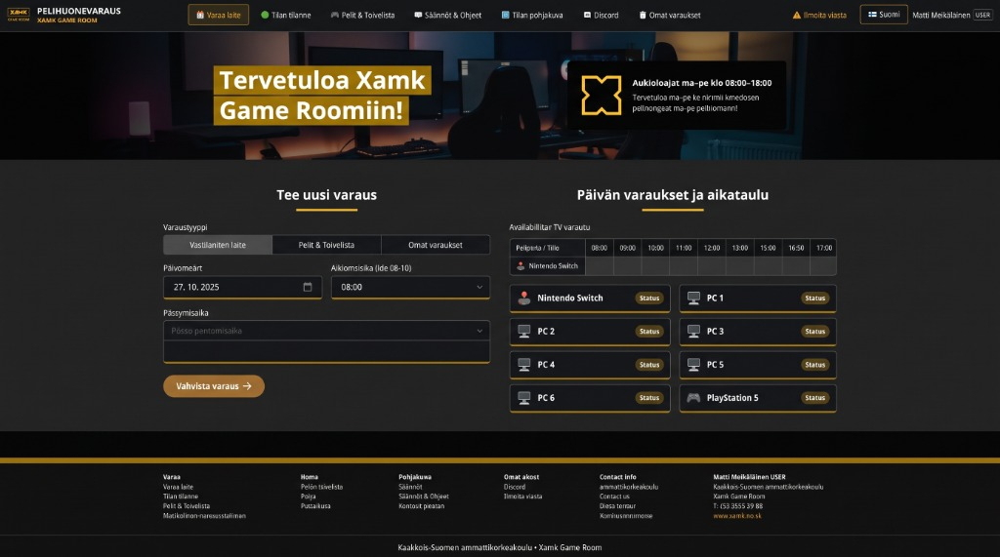
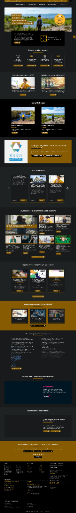

# UI Specification, Xamk Game Room (Pelihuonevaraus)

Spec-Driven Development (SDD) -määrittely käyttöliittymälle (`src/Client/**`). Tämä dokumentti määrittelee mitä käyttöliittymässä rakennetaan, miksi jokainen rakenne ja sääntö on olemassa, sekä miten [`DOMAIN_SPEC.md`](./DOMAIN_SPEC.md) ja [Xamkin brändiohjeisto](https://www.xamk.fi/en/xamk-brand-guidelines/) ohjaavat toteutusta.

---

## 1. Miksi tämä UI rakennetaan

Kaakkois-Suomen ammattikorkeakoulun (Xamk) pelihuoneessa on rajallinen määrä laitteita (6 kpl PC-pelipisteitä sekä PlayStation 5 ja Nintendo Switch, jotka jakavat yhteisen 4K-television). Ilman selkeää, reaaliaikaista ja säännöt pakottavaa käyttöliittymää syntyy kolme ongelmaa:

1. Tuplavaraukset ja SharedTV-ristiriidat: Opiskelijat varaavat PS5:n ja Switchin samaan aikaan tietämättä, että molemmat konsolit käyttävät samaa fyysistä televisiota.
2. Epäselvä tilannekuva: Kampukselle saapuva opiskelija ei tiedä, onko pelitila vapaana, varattuna yksittäisille pelaajille vai suljettuna turnauksen tai tapahtuman vuoksi.
3. Hajautunut ylläpito: Opettajilla (`SuperAdmin`) ja opiskelijaylläpitäjillä (`Admin`) ei ole yhtenäistä hallintapaneelia laiterikkojen, pelitoiveiden, tiedotteiden ja poikkeusvarausten (override) hoitamiseen.

SDD-periaate käyttöliittymässä: Käyttöliittymä on domain-invarianttien visuaalinen ohjauskerros. Jokainen komponentti estää virheellisen tilan syntymisen ennen palvelinkutsua ja heijastaa palvelimen palauttamat tilat (`409 Conflict`, `ProblemDetails`) välittömästi käyttäjälle.

---

## 2. Sanasto: toimialuemallin ja käyttöliittymän kytkennät

Sama termi tiedostossa [`DOMAIN_SPEC.md`](./DOMAIN_SPEC.md), API-sopimuksessa ja React-komponenteissa:

| Domain-käsite | UI-komponentti / Näkymä | Mitä rakennetaan | Miksi juuri näin |
| :--- | :--- | :--- | :--- |
| **GameRoom** | [`FloorPlanModal.tsx`](../../src/Client/src/components/FloorPlanModal.tsx), [`RealtimeStatus.tsx`](../../src/Client/src/components/RealtimeStatus.tsx) | Interaktiivinen pohjapiirros ja reaaliaikainen tilannekuva koko huoneesta. | Käyttäjä hahmottaa fyysisen tilan (PC 1-6, PS5, Switch ja yhteinen TV) yhdellä silmäyksellä ennen varausta. |
| **GamingStation** | `.xamk-station-row-card` ([`BookingCalendar.tsx`](../../src/Client/src/components/BookingCalendar.tsx)) | 8 laitekortin ruudukko (2×4) ja kompakti aikamatriisi. | Mahdollistaa vapaan laitteen ja kellonajan valinnan yhdellä klikkauksella ilman erillistä alasvetovalikkoa. |
| **Reservation** | [`BookingCalendar.tsx`](../../src/Client/src/components/BookingCalendar.tsx), [`MyBookings.tsx`](../../src/Client/src/components/MyBookings.tsx) | Varauslomake (`laite` tai `koko tila`) sekä omien tulevien ja menneiden varausten hallinta. | Erottaa yksittäisen opiskelijavarauksen (max 4 h) ja koko tilan varauksen, sekä estää jo alkaneen varauksen perumisen. |
| **SharedTV** | Konsolien ristiriitatunnistin ([`BookingCalendar.tsx`](../../src/Client/src/components/BookingCalendar.tsx)) | Visuaalinen varoitus ja lukitus, kun PS5 tai Switch on varattuna valitulle aikavälille. | Tekee säännön (PS5 ja Switch jakavat saman TV:n) näkyväksi laitetta valittaessa. |
| **OpeningHours** | Aikaslottien suodatus (`08:00-18:00`) | Kellonaikavalitsin ja aikamatriisi näyttävät vain sallitut 30 min ja 1 h aikaikkunat klo 08-18 välillä. | Estää virheelliset varausyritykset aukioloaikojen ulkopuolelle, paitsi `SuperAdmin`-tilassa. |
| **User / Guest** | [`LandingPage.tsx`](../../src/Client/src/components/LandingPage.tsx), [`LoginModal.tsx`](../../src/Client/src/components/LoginModal.tsx) | Kirjautumaton laskeutumissivu sekä 2-vaiheinen `@edu.xamk.fi` ja `@xamk.fi` -vahvistuskoodikirjautuminen. | Suojaa varauskalenterin ja käyttäjälistat kirjautumattomilta käyttäjiltä säilyttäen tiedotteet ja aukioloajat julkisina. |
| **Admin** | [`AdminPanel.tsx`](../../src/Client/src/components/AdminPanel.tsx) (`/admin/*`) | 6-välilehtinen hallintapaneeli (Pelit, Tiedotteet, Käyttäjät, Asetukset, Tilastot, Vikailmoitukset). | Keskittää päivittäisen ylläpidon yhteen URL-reititettyyn työpöytänäkymään. |
| **SuperAdmin** | [`SuperAdminPanel.tsx`](../../src/Client/src/components/SuperAdminPanel.tsx) (`/superadmin`) | Pääkäyttäjän jyräysvaraus (`override`), kaikkien varausten hallinta ja roolien korotus. | Mahdollistaa opettajille tapahtumien ja LAN-turnausten luomisen aukioloajoista riippumatta. |

---

## 3. Visuaalinen ilme ja Xamk-brändiohjeisto

Käyttöliittymä noudattaa [Xamkin graafista ohjeistoa](https://www.xamk.fi/en/xamk-brand-guidelines/) sekä alla olevia kahta referenssikuvaa.

### 3.0 Referenssikuvat

#### Referenssikuva 1: Päänäkymän rakenne ja komponentit

| Alue referenssikuvassa | Mitä rakennetaan | Vastaava toteutus koodissa |
| :--- | :--- | :--- |
| **1. Yksirivinen yläpalkki (`#0e0f11`)** | Vasemmalla kultareunuksinen logo ja otsikko; keskellä navigaatiolinkit kultaisella aktiivireunuksella (`#b58318`); oikealla vikailmoitus, kielenvaihtaja ja käyttäjäprofiili. | [`Navbar.tsx`](../../src/Client/src/components/Navbar.tsx), `.xamk-topbar` |
| **2. Hero-banneri ja kelluva infolaatikko** | Tumma pelihuonetaustakuva, vasemmalla kaksirivinen kultainen otsikkolaatikko, oikealla musta kelluva laatikko 4-lovisella `XamkXEmblem`-merkillä ja aukioloajoilla (`ma-pe klo 08:00-18:00`). | [`NewsBanner.tsx`](../../src/Client/src/components/NewsBanner.tsx), [`LandingPage.tsx`](../../src/Client/src/components/LandingPage.tsx) |
| **3. Kaksipalstainen pääsisältö (`#232323`)** | Vasemmalla Tee uusi varaus (segmentoitu valitsin, päivämäärä, aloitusaika, päättymisaika ja vahvistuspainike). Oikealla Päivän varaukset ja aikataulu (`08:00-17:00` -aikamatriisi ja laitekorttiruudukko). | [`BookingCalendar.tsx`](../../src/Client/src/components/BookingCalendar.tsx), `src/Client/src/components/ui/*` |
| **4. 6-sarakkeinen alapalkki kultaisella yläviivalla** | Koko leveyden kultainen erotinviiva (`.xamk-footer-gold-line`), linkkiryhmät ja alimmainen tekijänoikeuspalkki. | [`App.tsx`](../../src/Client/src/App.tsx), [`LandingPage.tsx`](../../src/Client/src/components/LandingPage.tsx) |

#### Referenssikuva 2: Xamk.fi, brändin rytmi, kortit ja typografia

| Xamk.fi-suunnittelukuvio | Miten sovellettu Pelihuonevarauksessa | Miksi |
| :--- | :--- | :--- |
| **Laatikoidut kultaiset otsikkonauhat** | `.xamk-highlight-strip` hero-otsikoissa. | Luo visuaalisen yhtenäisyyden Xamk.fi-pääsivuston kanssa. |
| **Keskelle tasatut väliotsikot 52px kultaviivalla** | `.xamk-section-heading` ja `.xamk-heading-underline` jokaisen osion alussa. | Jäsentää taustan selkeiksi osioiksi. |
| **4-sarakkeinen pikakorttirivi pyöreillä kultapillereillä** | `.xamk-landing-features-row` ja `.xamk-feature-mini-card` laskeutumissivun yläosassa. | Tarjoaa vierailijalle toiminnot yhdellä silmäyksellä. |
| **Korttien 2px kultainen alareuna (`#c89211` / `#d49a2a`)** | Kaikki laitekortit, uutiskortit, modaalit ja syötekentät. | Korvaa raskaan varjostuksen terävällä reunuksella. |

### 3.1 Väripaletti ja kontrastit (`src/Client/src/index.css`)
- Xamk Keltainen ja Kulta (`#fbba18`, `#e5a812`, `#d49a2a`, `#c89211`):
  - Käytetään otsikoiden taustanauhoissa (`.xamk-highlight-strip`), väliotsikoiden 52px alleviivauksissa (`.xamk-heading-underline`), korttien ja syötekenttien 2px alareunassa (`border-bottom: 2px solid #c89211`), toimintopainikkeissa sekä näppäimistön `:focus-visible`-reunuksessa.
- Tummat grafiitti- ja hiilipinnat (`#0e0f11`, `#111111`, `#1b1c20`, `#232323`):
  - Yläpalkki `#0e0f11`, pääsisältöpinta `#232323`, kortit `#1b1c20`, syötekentät `#16171b` ja alapalkki `#111111`.
  - Täyttää WCAG 2.1 AA -kontrastivaatimukset (`--text-primary: #f5f6f8`, `--text-secondary: #b0b6c2`, `--text-muted: #8b92a0`).

### 3.2 Tunnus, X-liikemerkki ja 4 kampusta
- Virallinen Xamk-kehystunnus (`xamk_logo_tiivis_kehys_keltainen_rgb.png`):
  - Yläpalkin vasemmassa reunassa ([`Navbar.tsx`](../../src/Client/src/components/Navbar.tsx), [`LandingPage.tsx`](../../src/Client/src/components/LandingPage.tsx)) käytetään virallista keltaista kehystettyä Xamk-logoa.
- 4-haarainen X-liikemerkki (`XamkXEmblem`):
  - Neliömäinen kehys, jonka jokaisella sivulla on kolmiomainen lovi, piirrettynä SVG-vektorina hero-bannerin infolaatikossa. Sakarat symboloivat neljää kampusta (Kotka, Kouvola, Mikkeli ja Savonlinna).
- Kampukset ja virallinen kaksikielisyys:
  - Alapalkissa esitetään kaikki neljä kampusta, virallinen nimi (*Kaakkois-Suomen ammattikorkeakoulu* ja *South-Eastern Finland UAS*) sekä tunnuslause.

### 3.3 Typografia ja kosketusergonomia
- Fonttiperhe: `'Montserrat', 'Open Sans'` ja järjestelmän geometriset sans-serif-varafontit.
- Kosketusalueet (`.btn-touch`): jokainen interaktiivinen painike, välilehti ja valitsin on vähintään `44×44 px` mobiilikäytettävyyden varmistamiseksi.

---

## 4. Arkkitehtuuri: reititys ja komponenttikirjasto

### 4.1 URL-reititys (`src/Client/src/router.tsx`)
HTML5 History API -pohjainen reititin (`RouterProvider`), joka synkronoi aktiivisen näkymän selaimen osoiteriville:
- `/book`: Varauskalenteri ja päivän aikamatriisi
- `/status`: Reaaliaikainen tilan tilanne
- `/games`: Pelikatalogi ja yhteisön toivelista
- `/rules`: Säännöt ja laiteopas
- `/my-bookings`: Omat varaukset
- `/admin/games`, `/admin/news`, `/admin/users`, `/admin/settings`, `/admin/statistics`, `/admin/issues`: Ylläpitäjän hallintanäkymät
- `/superadmin`: Pääkäyttäjän jyräys- ja järjestelmänhallinta

### 4.2 UI-primitiivit (`src/Client/src/components/ui/`)
- Uudelleenkäytettävät UI-primitiivit: `button.tsx`, `dialog.tsx`, `dropdown-menu.tsx`, `tabs.tsx`, `table.tsx`, `card.tsx`, `badge.tsx`, `input.tsx`, `native-select.tsx`, `textarea.tsx`, `label.tsx`.
- Radix UI -primitiivit takaavat saavutettavuuden.

---

## 5. Näkymäkohtainen spesifikaatio

### 5.1 Kirjautumaton näkymä ja yläpalkin lukitus ([`LandingPage.tsx`](../../src/Client/src/components/LandingPage.tsx), [`Navbar.tsx`](../../src/Client/src/components/Navbar.tsx))
- Kun `user === null`, yläpalkissa näytetään vain Xamk-brändilogo, kielenvaihtaja (`LanguageSwitcher`) ja kirjautumispainike. Kaikki navigaatiovälilehdet piilotetaan.
- Pääsisällössä näytetään hero-banneri, 4 pikakorttia (aukioloajat, laitteisto, pohjakuva, Discord), 2-vaiheinen sähköpostikirjautuminen (`@edu.xamk.fi` ja `@xamk.fi`) sekä kiinnitetyt tiedotteet ja tiivistetyt pelisäännöt.

### 5.2 Varauskalenteri ja aikamatriisi ([`BookingCalendar.tsx`](../../src/Client/src/components/BookingCalendar.tsx))
- Vasen sarake ("Tee uusi varaus"): Segmentoitu varaustyypin valitsin (`Yksittäinen laite` tai `Koko pelitila`), päivämäärävalitsin, aloitusaikavalitsin (`08:00-17:30`), päättymisaikavalitsin (`+30 min` - `max 4 h`), laitevalitsin sekä vahvistuspainike.
- Oikea sarake ("Päivän varaukset ja aikataulu"):
  - Kaikkien 8 laitteen aikataulumatriisi (`08:00-17:00`): jokaisella pelipisteellä (`Nintendo Switch`, `PC 1`-`PC 6`, `PlayStation 5`) on oma rivinsä taulukossa.
  - Aikaikkunan maalaus hiirellä (Drag-to-Select): käyttäjä voi klikata tai vetää hiiren kursorilla vapaiden tuntisolujen yli valitakseen suoraan halutun laitteen sekä aloitus- ja päättymisajan.
  - 2×4 laitekorttiruudukko: pikavalintakortit kaikille 8 laitteelle, joissa on reaaliaikainen `Status`-indikaattori.

### 5.3 Reaaliaikainen tilanne ([`RealtimeStatus.tsx`](../../src/Client/src/components/RealtimeStatus.tsx))
Laskettu näkymä, joka näyttää juuri tällä hetkellä vapaat ja varatut pelipisteet, seuraavan alkavan varauksen sekä pikapainikkeen vapaan laitteen varaamiseen. Vapaata tilaa ei tallenneta erillisenä kantatilana, vaan se johdetaan aktiivisista varauksista ja kellonajasta.

### 5.4 Pelikatalogi ja yhteisön toivelista ([`GamesCatalog.tsx`](../../src/Client/src/components/GamesCatalog.tsx))
Alustasuodattimet (`Kaikki`, `PC`, `PS5`, `Switch`, `Toivelista`), tekstihaku, asennettujen pelien kortit sekä opiskelijoiden ehdotuslomake ja äänestyspainike.

### 5.5 Modaalit ja ylläpitopaneelit ([`IssueReportModal.tsx`](../../src/Client/src/components/IssueReportModal.tsx), [`AdminPanel.tsx`](../../src/Client/src/components/AdminPanel.tsx), [`SuperAdminPanel.tsx`](../../src/Client/src/components/SuperAdminPanel.tsx))
- Modaalit (`Dialog`): yhtenäinen rakenne kultaisella ylä- ja alareunalla, ikonikortilla ja selkeillä syötekentillä.
- Admin ja SuperAdmin (`Tabs`, `Table`, `Card`): tilastokorttien ylärivi, alavälilehtinavigaatio sekä kaksipalstainen lomake ja datataulukko.

---

## 6. Käyttöliittymän invariantit ja hyväksymiskriteerit

| # | UI-invariantti ja sääntö | Missä pakotetaan | Miksi | Miten todennetaan |
| :- | :--- | :--- | :--- | :--- |
| **UI-1** | Kirjautumaton käyttäjä näkee yläpalkissa vain kielenvaihtajan ja kirjautumispainikkeen. | [`LandingPage.tsx`](../../src/Client/src/components/LandingPage.tsx), [`Navbar.tsx`](../../src/Client/src/components/Navbar.tsx) | Estää navigoinnin varaus- ja hallintanäkymiin. | Tarkista näkymä, kun `user === null`. |
| **UI-2** | Konsolien `SharedTV`-lukko estää PS5:n valinnan, jos Switch on varattu samalle ajalle. | [`BookingCalendar.tsx`](../../src/Client/src/components/BookingCalendar.tsx) | Heijastaa sääntöä suoraan käyttöliittymässä. | Valitse aikaikkuna, jossa toinen konsoli on varattu, jolloin toinen konsoli näyttää SharedTV-lukon. |
| **UI-3** | Jokaisella näkymällä ja ylläpidon välilehdellä on oma URL-polku. | [`router.tsx`](../../src/Client/src/router.tsx), [`App.tsx`](../../src/Client/src/App.tsx) | Mahdollistaa linkityksen ja selainhistorian. | Navigoi välilehtien välillä ja varmista `window.location.pathname`-päivitys. |
| **UI-4** | Kaikki tekstit toimivat sekä suomeksi (`fi`) että englanniksi (`en`) ilman raakoja käännösavaimia. | [`LanguageContext.tsx`](../../src/Client/src/context/LanguageContext.tsx) | Kaksikielinen korkeakouluympäristö. | Vaihda kieli ja tarkista modaalit, lomakkeet ja alapalkki. |
| **UI-5** | Nolla TypeScript- tai ESLint-virhettä ja varoitusta. | `src/Client/**` | Tuotantotason koodinlaatu ja tyyppiturvallisuus. | Aja `npm --prefix src/Client run build && npm --prefix src/Client run lint` (exit code `0`). |
| **UI-6** | Aikataulumatriisi listaa kaikki 8 laitetta ja tukee aloitus- ja päättymisajan valintaa hiirellä. | [`BookingCalendar.tsx`](../../src/Client/src/components/BookingCalendar.tsx) | Antaa kokonaiskuvan laitteista ja nopeuttaa valintaa. | Vedä hiirellä vapaiden solujen yli taulukossa, jolloin laite, aloitusaika ja päättymisaika päivittyvät. |
