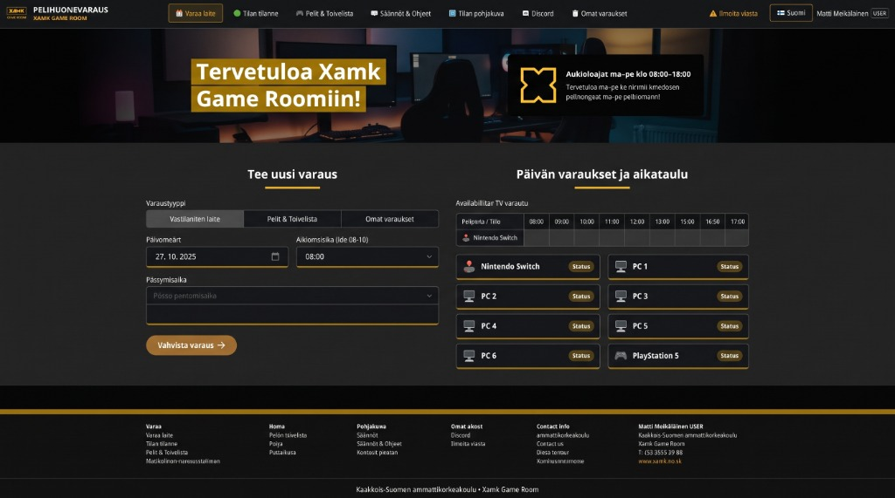
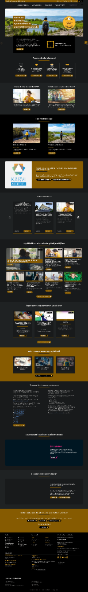

# UI Specification — Xamk Game Room (Pelihuonevaraus)

Spec-Driven Development (SDD) -määrittely käyttöliittymälle (`src/Client/**`). Tämä dokumentti määrittelee **mitä** käyttöliittymässä rakennetaan, **miksi** jokainen rakenne ja sääntö on olemassa, sekä miten [`DOMAIN_SPEC.md`](./DOMAIN_SPEC.md) ja [Xamkin brändiohjeisto](https://www.xamk.fi/en/xamk-brand-guidelines/) ohjaavat toteutusta.

---

## 1. Miksi tämä UI rakennetaan? (Purpose & Problem Statement)

Kaakkois-Suomen ammattikorkeakoulun (Xamk) pelihuoneessa on rajallinen määrä laitteita (**6 kpl PC-pelipisteitä** sekä **PlayStation 5** ja **Nintendo Switch**, jotka jakavat **yhteisen 4K-television**). Ilman selkeää, reaaliaikaista ja säännöt pakottavaa käyttöliittymää syntyy kolme kriittistä ongelmaa:

1. **Tuplavaraukset ja SharedTV-ristiriidat:** Opiskelijat varaavat PS5:n ja Switchin samaan aikaan tietämättä, että molemmat konsolit käyttävät samaa fyysistä televisiota.
2. **Epäselvä tilannekuva:** Kampukselle saapuva opiskelija ei tiedä, onko pelitila vapaana, varattuna yksittäisille pelaajille vai suljettuna turnauksen/tapahtuman vuoksi.
3. **Hajautunut ylläpito:** Opettajilla (`SuperAdmin`) ja opiskelijaylläpitäjillä (`Admin`) ei ole yhtenäistä hallintapaneelia laiterikkojen, pelitoiveiden, tiedotteiden ja poikkeusvarausten (override) hoitamiseen.

**SDD-periaate käyttöliittymässä:** Käyttöliittymä ei ole pelkkä lomakekokoelma, vaan **domain-invarianttien visuaalinen ohjauskerros**. Jokainen UI-komponentti estää virheellisen tilan syntymisen jo ennen palvelinkutsua ja heijastaa palvelimen palauttamat tilat (`409 Conflict`, `ProblemDetails`) välittömästi käyttäjälle.

---

## 2. Sanasto: Domain → UI -sillat (Ubiquitous Language)

Sama termi [`DOMAIN_SPEC.md`](./DOMAIN_SPEC.md) -dokumentissa, API-sopimuksessa ja React-komponenteissa:

| Domain-käsite | UI-komponentti / Näkymä | Mitä rakennetaan | Miksi juuri näin |
| :--- | :--- | :--- | :--- |
| **GameRoom** | [`FloorPlanModal.tsx`](../../src/Client/src/components/FloorPlanModal.tsx), [`RealtimeStatus.tsx`](../../src/Client/src/components/RealtimeStatus.tsx) | Interaktiivinen pohjapiirros ja reaaliaikainen tilannekuva koko huoneesta. | Käyttäjä hahmottaa fyysisen tilan (PC 1–6, PS5, Switch ja yhteinen TV) yhdellä silmäyksellä ennen varausta. |
| **GamingStation** | `.xamk-station-row-card` ([`BookingCalendar.tsx`](../../src/Client/src/components/BookingCalendar.tsx)) | 8 laitekortin ruudukko (2×4) ja kompakti aikamatriisi. | Mahdollistaa vapaan laitteen ja kellonajan valinnan yhdellä klikkauksella ilman erillistä alasvetovalikkoa. |
| **Reservation** | [`BookingCalendar.tsx`](../../src/Client/src/components/BookingCalendar.tsx), [`MyBookings.tsx`](../../src/Client/src/components/MyBookings.tsx) | Varauslomake (`laite` / `koko tila`) sekä omien tulevien ja menneiden varausten hallinta. | Erottaa yksittäisen opiskelijavarauksen (max 4 h) ja koko tilan varauksen, sekä estää jo alkaneen varauksen perumisen (Invariantti #5). |
| **SharedTV** | Konsolien ristiriitatunnistin ([`BookingCalendar.tsx`](../../src/Client/src/components/BookingCalendar.tsx)) | Visuaalinen varoitus ja lukitus, kun PS5 tai Switch on varattuna valitulle aikavälille. | Tekee Domain-invariantin #6 (*PS5 ja Switch eivät voi olla yhtä aikaa päällä*) näkyväksi jo laitetta valittaessa. |
| **OpeningHours** | Aikaslottien suodatus (`08:00–18:00`) | Kellonaikavalitsin ja aikamatriisi näyttävät vain sallitut 30 min / 1 h aikaikkunat klo 08–18 välillä. | Estää virheelliset varausyritykset aukioloaikojen ulkopuolelle (Invariantti #2), paitsi `SuperAdmin`-tilassa. |
| **User / Guest** | [`LandingPage.tsx`](../../src/Client/src/components/LandingPage.tsx), [`LoginModal.tsx`](../../src/Client/src/components/LoginModal.tsx) | Kirjautumaton laskeutumissivu sekä 2-vaiheinen `@edu.xamk.fi` / `@xamk.fi` -vahvistuskoodikirjautuminen. | Suojaa varauskalenterin ja käyttäjälistat kirjautumattomilta käyttäjiltä (Invariantti #7) säilyttäen tiedotteet ja aukioloajat julkisina. |
| **Admin** | [`AdminPanel.tsx`](../../src/Client/src/components/AdminPanel.tsx) (`/admin/*`) | 6-välilehtinen hallintapaneeli (Pelit, Tiedotteet, Käyttäjät, Asetukset, Tilastot, Vikailmoitukset). | Keskittää päivittäisen ylläpidon yhteen URL-reititettyyn työpöytänäkymään. |
| **SuperAdmin** | [`SuperAdminPanel.tsx`](../../src/Client/src/components/SuperAdminPanel.tsx) (`/superadmin`) | Pääkäyttäjän jyräysvaraus (`override`), kaikkien varausten hallinta ja roolien korotus. | Mahdollistaa opettajille tapahtumien ja LAN-turnausten luomisen aukioloajoista riippumatta (Invariantti #8). |

---

## 3. Visuaalinen ilme & Xamk-brändiohjeisto (What & Why for Design System)

Käyttöliittymä noudattaa [Xamkin graafista ohjeistoa](https://www.xamk.fi/en/xamk-brand-guidelines/) sekä alla olevia kahta virallista referenssikuvaa.

### 3.0 Referenssikuvat (Visual Reference Baseline)

#### Referenssikuva 1: Pelihuonevaraus — Päänäkymän rakenne ja komponentit

| Alue referenssikuvassa | Mitä rakennetaan | Vastaava toteutus koodissa |
| :--- | :--- | :--- |
| **1. Yksirivinen yläpalkki (`#0e0f11`)** | Vasemmalla kultareunuksinen `XAMK GAME ROOM` -merkki + `PELIHUONEVARAUS`; keskellä 7 navigaatiolinkkiä (aktiivisella välilehdellä kultainen reunus `#b58318`); oikealla `Ilmoita viasta`, kielenvaihtaja (`Suomi` / `English`) ja käyttäjäprofiili (`Matti Meikäläinen USER`). | [`Navbar.tsx`](../../src/Client/src/components/Navbar.tsx), `.xamk-topbar` |
| **2. Hero-banneri & kelluva infolaatikko** | Tumma pelihuonetaustakuva, vasemmalla kaksirivinen kultainen otsikkolaatikko (`Tervetuloa Xamk` / `Game Roomiin!`), oikealla musta kelluva laatikko, jossa on 4-lovinen `XamkXEmblem`-vektorimerkki ja aukioloajat (`ma–pe klo 08:00–18:00`). | [`NewsBanner.tsx`](../../src/Client/src/components/NewsBanner.tsx), [`LandingPage.tsx`](../../src/Client/src/components/LandingPage.tsx) |
| **3. Kaksipalstainen pääsisältö (`#232323`)** | Vasemmalla **Tee uusi varaus** (segmentoitu valitsin, rinnakkaiset päivämäärä- ja aloitusaikakentät kultaisella alareunalla, kaksiosainen päättymisaikalaatikko ja pyöreä kultainen `Vahvista varaus →` -painike). Oikealla **Päivän varaukset ja aikataulu** (kompakti `08:00–17:00` -aikamatriisi + 2×4 laitekorttiruudukko `Status`-pillerillä). | [`BookingCalendar.tsx`](../../src/Client/src/components/BookingCalendar.tsx), `src/Client/src/components/ui/*` |
| **4. 6-sarakkeinen alapalkki kultaisella yläviivalla** | Koko leveyden kultainen erotinviiva (`.xamk-footer-gold-line`), 6 sarakkeen linkkiryhmät (`Varaa`, `Tietoa`, `Pohjakuva`, `Omat tiedot`, `Contact info`, organisaatiotiedot) ja alimmainen tekijänoikeuspalkki. | [`App.tsx`](../../src/Client/src/App.tsx), [`LandingPage.tsx`](../../src/Client/src/components/LandingPage.tsx) |

#### Referenssikuva 2: Xamk.fi — Brändin rytmi, kortit ja typografia

| Xamk.fi-suunnittelukuvio | Miten sovellettu Pelihuonevarauksessa | Miksi |
| :--- | :--- | :--- |
| **Laatikoidut kultaiset otsikkonauhat** | `.xamk-highlight-strip` hero-otsikoissa. | Luo välittömän visuaalisen yhtenäisyyden Xamk.fi-pääsivuston kanssa. |
| **Keskelle tasatut väliotsikot 52px kultaviivalla** | `.xamk-section-heading` + `.xamk-heading-underline` jokaisen osion alussa. | Jäsentää tumman `#232323`-taustan selkeiksi, helposti silmäiltäviksi osioiksi. |
| **4-sarakkeinen pikakorttirivi pyöreillä kultapillereillä** | `.xamk-landing-features-row` ja `.xamk-feature-mini-card` kirjautumattoman laskeutumissivun yläosassa. | Tarjoaa vierailijalle keskeiset toiminnot (aukioloajat, tilan tilanne, pohjakuva, Discord) yhdellä silmäyksellä. |
| **Korttien 2px kultainen alareuna (`#c89211` / `#d49a2a`)** | Kaikki laitekortit, uutiskortit, modaalit, syötekentät ja ylläpidon KPI-kortit. | Korvaa raskaan varjostuksen terävällä, Xamk-brändin mukaisella reunuksella. |

### 3.1 Väripaletti ja kontrastit (`src/Client/src/index.css`)
- **Xamk Keltainen / Kulta (`#fbba18` / `#e5a812` / `#d49a2a` / `#c89211`):**
  - *Mitä:* Käytetään otsikoiden taustanauhoissa (`.xamk-highlight-strip`), väliotsikoiden 52px alleviivauksissa (`.xamk-heading-underline`), korttien ja syötekenttien 2px alareunassa (`border-bottom: 2px solid #c89211`), toimintopainikkeissa (`variant="pill"`) sekä näppäimistön `:focus-visible`-reunuksessa.
  - *Miksi:* Luo välittömästi tunnistettavan Xamk-identiteetin tummalla taustalla ja ohjaa käyttäjän katseen ensisijaisiin toimintoihin.
- **Tummat grafiitti- ja hiilipinnat (`#0e0f11`, `#111111`, `#1b1c20`, `#232323`):**
  - *Mitä:* Yläpalkki `#0e0f11`, pääsisältöpinta `#232323`, kortit `#1b1c20`, syötekentät `#16171b` ja alapalkki `#111111`.
  - *Miksi:* Pelitilan hämärään ympäristöön sopiva tumma teema, joka täyttää WCAG 2.1 AA -kontrastivaatimukset (`--text-primary: #f5f6f8`, `--text-secondary: #b0b6c2`, `--text-muted: #8b92a0`).

### 3.2 Tunnus, "X"-liikemerkki ja 4 kampusta
- **Virallinen Xamk-kehystunnus (`xamk_logo_tiivis_kehys_keltainen_rgb.png`):**
  - *Mitä:* Yläpalkin vasemmassa reunassa ([`Navbar.tsx`](../../src/Client/src/components/Navbar.tsx), [`LandingPage.tsx`](../../src/Client/src/components/LandingPage.tsx)) käytetään virallista keltaista kehystettyä Xamk-logoa (`./images/xamk_logo_tiivis_kehys_keltainen_rgb.png`, julkaistu polussa `/xamk_logo_tiivis_kehys_keltainen_rgb.png`).
  - 
- **4-haarainen "X"-liikemerkki (`XamkXEmblem`):**
  - *Mitä:* Neliömäinen kehys, jonka jokaisella sivulla on kolmiomainen lovi, piirrettynä SVG-vektorina hero-bannerin infolaatikossa ([`NewsBanner.tsx`](../../src/Client/src/components/NewsBanner.tsx), [`LandingPage.tsx`](../../src/Client/src/components/LandingPage.tsx)).
  - *Miksi:* Xamkin virallinen graafinen tunnusmerkki, jonka neljä sakaraa symboloivat Xamkin neljää kampusta (**Kotka • Kouvola • Mikkeli • Savonlinna**).
- **Kampukset ja virallinen kaksikielisyys:**
  - *Mitä:* Alapalkissa ([`App.tsx`](../../src/Client/src/App.tsx), [`LandingPage.tsx`](../../src/Client/src/components/LandingPage.tsx)) esitetään kaikki neljä kampusta, virallinen nimi (*Kaakkois-Suomen ammattikorkeakoulu* / *South-Eastern Finland UAS*) sekä tunnuslause (*Tulevaisuutta varten* / *All for the future*).
  - *Miksi:* Varmistaa brändiohjeiston mukaisen organisaatiotiedon sekä suomeksi (`fi`) että englanniksi (`en`).

### 3.3 Typografia ja kosketusergonomia
- **Fonttiperhe:** `'Montserrat', 'Open Sans'` ja järjestelmän geometriset sans-serif-varafontit.
- **Kosketusalueet (`.btn-touch`):** Jokainen interaktiivinen painike, välilehti ja valitsin on vähintään `44×44 px` mobiilikäytettävyyden varmistamiseksi.

---

## 4. Arkkitehtuuri: Reititys ja `shadcn/ui`-komponenttikirjasto

### 4.1 URL-reititys (`src/Client/src/router.tsx`)
- **Mitä rakennetaan:** HTML5 History API -pohjainen reititin (`RouterProvider`, `useRouter`), joka synkronoi aktiivisen näkymän ja ylläpidon alavälilehden suoraan selaimen osoiteriville:
  - `/book` — Varauskalenteri ja päivän aikamatriisi
  - `/status` — Reaaliaikainen tilan tilanne
  - `/games` — Pelikatalogi ja yhteisön toivelista
  - `/rules` — Säännöt ja laiteopas
  - `/my-bookings` — Omat varaukset
  - `/admin/games`, `/admin/news`, `/admin/users`, `/admin/settings`, `/admin/statistics`, `/admin/issues` — Ylläpitäjän hallintanäkymät
  - `/superadmin` — Pääkäyttäjän jyräys- ja järjestelmänhallinta
- **Miksi:** Mahdollistaa suorien linkkien jakamisen (esim. ylläpitäjä voi avata suoraan `/admin/issues`), selaimen Edellinen/Seuraava-painikkeiden toiminnan sekä sivun päivittämisen (`F5`) ilman näkymätilan katoamista.

### 4.2 `shadcn/ui`-pohjaiset UI-primitiivit (`src/Client/src/components/ui/`)
- **Mitä rakennetaan:** Uudelleenkäytettävät, tyyppiturvalliset UI-primitiivit ([`button.tsx`](../../src/Client/src/components/ui/button.tsx), [`dialog.tsx`](../../src/Client/src/components/ui/dialog.tsx), [`dropdown-menu.tsx`](../../src/Client/src/components/ui/dropdown-menu.tsx), [`tabs.tsx`](../../src/Client/src/components/ui/tabs.tsx), [`table.tsx`](../../src/Client/src/components/ui/table.tsx), [`card.tsx`](../../src/Client/src/components/ui/card.tsx), [`badge.tsx`](../../src/Client/src/components/ui/badge.tsx), [`input.tsx`](../../src/Client/src/components/ui/input.tsx), [`native-select.tsx`](../../src/Client/src/components/ui/native-select.tsx), [`textarea.tsx`](../../src/Client/src/components/ui/textarea.tsx), [`label.tsx`](../../src/Client/src/components/ui/label.tsx)).
- **Miksi:**
  - Radix UI -primitiivit (`@radix-ui/react-dialog`, `@radix-ui/react-dropdown-menu`, `@radix-ui/react-tabs`, `@radix-ui/react-slot`) takaavat saavutettavuuden (fokuslukko modaalissa, `Escape`-sulkeminen, nuolinäppäinnavigaatio, `aria-*`-attribuutit).
  - Räätälöidyt CVA-variantit (`variant="pill"`, `variant="xamk"`, `variant="segment"`, `variant="station"`) yhdistävät `shadcn/ui`-ergonomian täsmälliseen Xamk-referenssiulkoasuun.

---

## 5. Näkymäkohtainen spesifikaatio (What to Build & Why)

### 5.1 Kirjautumaton näkymä & Yläpalkin lukitus ([`LandingPage.tsx`](../../src/Client/src/components/LandingPage.tsx), [`Navbar.tsx`](../../src/Client/src/components/Navbar.tsx))
- **Mitä:**
  - Kun `user === null`, yläpalkissa näytetään **vain** Xamk-brändilogo, kielenvaihtaja (`LanguageSwitcher`) ja `Kirjaudu sisään →` -painike. Kaikki navigaatiovälilehdet piilotetaan.
  - Pääsisällössä näytetään hero-banneri, 4 pikakorttia (aukioloajat, laitteisto, pohjakuva, Discord), 2-vaiheinen sähköpostikirjautuminen (`@edu.xamk.fi` / `@xamk.fi`) sekä kiinnitetyt tiedotteet ja tiivistetyt pelisäännöt.
- **Miksi:** Estää kirjautumattomia käyttäjiä pääsemästä varausnäkymiin tai ylläpitoon, mutta tarjoaa kampuksen opiskelijoille välittömästi olennaiset tiedot ja nopean kirjautumispolun.

### 5.2 Varauskalenteri & Aikamatriisi ([`BookingCalendar.tsx`](../../src/Client/src/components/BookingCalendar.tsx))
- **Mitä:**
  - **Vasen sarake ("Tee uusi varaus"):** Segmentoitu varaustyypin valitsin (`Yksittäinen laite` / `Koko pelitila`), päivämäärävalitsin, aloitusaikavalitsin (`08:00–17:30`), päättymisaikavalitsin (`+30 min` … `max 4h`), laitevalitsin sekä pyöreä kultainen `Vahvista varaus →` -painike.
  - **Oikea sarake ("Päivän varaukset ja aikataulu"):**
    - **Kaikkien 8 laitteen aikataulumatriisi (`08:00–17:00`):** Jokaisella pelipisteellä (`Nintendo Switch`, `PC 1`–`PC 6`, `PlayStation 5`) on oma rivinsä taulukossa, jotta koko päivän varaustilanne ja yhteisen TV:n (`SharedTV`) varaukset näkyvät kerralla.
    - **Aikaikkunan maalaus hiirellä (Drag-to-Select):** Käyttäjä voi klikata tai vetää hiiren kursorilla vapaiden tuntisolujen yli valitakseen suoraan halutun laitteen sekä aloitus- ja päättymisajan (rajoitettuna enimmäiskestoon ja pysähtyen varattuihin soluihin).
    - **2×4 laitekorttiruudukko:** Pikavalintakortit kaikille 8 laitteelle, joissa on reaaliaikainen `Status`-indikaattori.
  - **Älykäs oletusaika:** Jos kello on yli 17:00 tai on viikonloppu, päivämäärävalitsin siirtyy automaattisesti seuraavaan arkipäivään.
  - **Idempotenssi (`Idempotency-Key`):** Jokainen varauspyyntö lähettää uniikin avaimen, ja `409 Conflict` invalidoi varausvälimuistin välittömästi.
- **Miksi:** Yhdistää lomakepohjaisen ja visuaalisen aikataulunäkymän samaan ruutuun, jolloin vapaa laite ja aikaikkuna löytyvät ja valitaan yhdellä hiiren vedolla.

### 5.3 Reaaliaikainen tilanne ([`RealtimeStatus.tsx`](../../src/Client/src/components/RealtimeStatus.tsx))
- **Mitä:** Laskettu näkymä, joka näyttää juuri tällä hetkellä vapaat ja varatut pelipisteet, seuraavan alkavan varauksen sekä pikapainikkeen vapaan laitteen varaamiseen.
- **Miksi:** Toteuttaa [`DOMAIN_SPEC.md`](./DOMAIN_SPEC.md) -määrittelyn kohdan *"Laskettu näkymä: Reaaliaikainen tilanne"* — vapaata tilaa ei tallenneta erillisenä kantatilana, vaan se johdetaan aktiivisista varauksista ja kellonajasta.

### 5.4 Pelikatalogi & Yhteisön toivelista ([`GamesCatalog.tsx`](../../src/Client/src/components/GamesCatalog.tsx))
- **Mitä:** Alustasuodattimet (`Kaikki`, `PC`, `PS5`, `Switch`, `Toivelista`), tekstihaku, asennettujen pelien kortit sekä opiskelijoiden "Toivo uutta peliä" -lomake ja äänestyspainike (`upvote`).
- **Miksi:** Antaa opiskelijoille näkyvyyden asennettuihin peleihin ennen laitteen varaamista ja ohjaa hankintatoiveet suoraan ylläpidon jonoon.

### 5.5 Modaalit & Ylläpitopaneelit ([`IssueReportModal.tsx`](../../src/Client/src/components/IssueReportModal.tsx), [`AdminPanel.tsx`](../../src/Client/src/components/AdminPanel.tsx), [`SuperAdminPanel.tsx`](../../src/Client/src/components/SuperAdminPanel.tsx))
- **Mitä:**
  - **Modaalit (`Dialog`):** Yhtenäinen `.xamk-dialog-content` -rakenne kultaisella ylä- ja alareunalla (`#d49a2a`), ikonikortilla ja selkeillä syötekentillä (`.xamk-input-box`, `.xamk-select-box`, `.xamk-textarea-box`).
  - **Admin & SuperAdmin (`Tabs`, `Table`, `Card`):** 4 KPI-tilastokortin ylärivi, alavälilehtinavigaatio sekä kaksipalstainen lomake + datataulukko -asettelu.
- **Miksi:** Takaa, että vikailmoitukset, pelikirjaston hallinta, tiedotteet ja `SuperAdmin`-jyräysvaraukset toimivat samalla visuaalisella ja toiminnallisella logiikalla kuin päävarausnäkymä.

---

## 6. Käyttöliittymän invariantit & Hyväksymiskriteerit (SDD Verification Matrix)

| # | UI-invariantti / Sääntö | Missä pakotetaan | Miksi | Miten todennetaan |
| :- | :--- | :--- | :--- | :--- |
| **UI-1** | Kirjautumaton käyttäjä näkee yläpalkissa vain kielenvaihtajan ja kirjautumispainikkeen. | [`LandingPage.tsx`](../../src/Client/src/components/LandingPage.tsx), [`Navbar.tsx`](../../src/Client/src/components/Navbar.tsx) | Estää luvattoman navigoinnin varaus- ja hallintanäkymiin. | Tarkista näkymä, kun `user === null`. |
| **UI-2** | Konsolien `SharedTV`-lukko estää PS5:n valinnan, jos Switch on varattu samalle ajalle (ja päinvastoin). | [`BookingCalendar.tsx`](../../src/Client/src/components/BookingCalendar.tsx) | Heijastaa Domain-invarianttia #6 suoraan käyttöliittymässä. | Valitse aikaikkuna, jossa toinen konsoli on varattu → toinen konsoli näyttää SharedTV-lukon. |
| **UI-3** | Jokaisella näkymällä ja ylläpidon välilehdellä on oma URL-polku. | [`router.tsx`](../../src/Client/src/router.tsx), [`App.tsx`](../../src/Client/src/App.tsx) | Mahdollistaa syvälinkityksen ja selainhistorian. | Navigoi välilehtien välillä ja varmista `window.location.pathname`-päivitys. |
| **UI-4** | Kaikki tekstit toimivat sekä suomeksi (`fi`) että englanniksi (`en`) ilman raakoja käännösavaimia. | [`LanguageContext.tsx`](../../src/Client/src/context/LanguageContext.tsx) | Kaksikielinen korkeakouluympäristö (Xamk). | Vaihda kieli `Suomi` ↔ `English` ja tarkista modaalit, lomakkeet ja alapalkki. |
| **UI-5** | Nolla TypeScript- tai ESLint-virhettä ja varoitusta. | `src/Client/**` | Tuotantotason koodinlaatu ja tyyppiturvallisuus. | Aja `npm --prefix src/Client run build && npm --prefix src/Client run lint` (exit code `0`). |
| **UI-6** | Aikataulumatriisi listaa kaikki 8 laitetta ja tukee aloitus-/päättymisajan valintaa hiirellä raahaamalla. | [`BookingCalendar.tsx`](../../src/Client/src/components/BookingCalendar.tsx) | Antaa kokonaiskuvan kaikista laitteista ja nopeuttaa aikavälin valintaa. | Vedä hiirellä vapaiden tuntisolujen yli taulukossa → laite, aloitusaika ja päättymisaika päivittyvät automaattisesti. |

