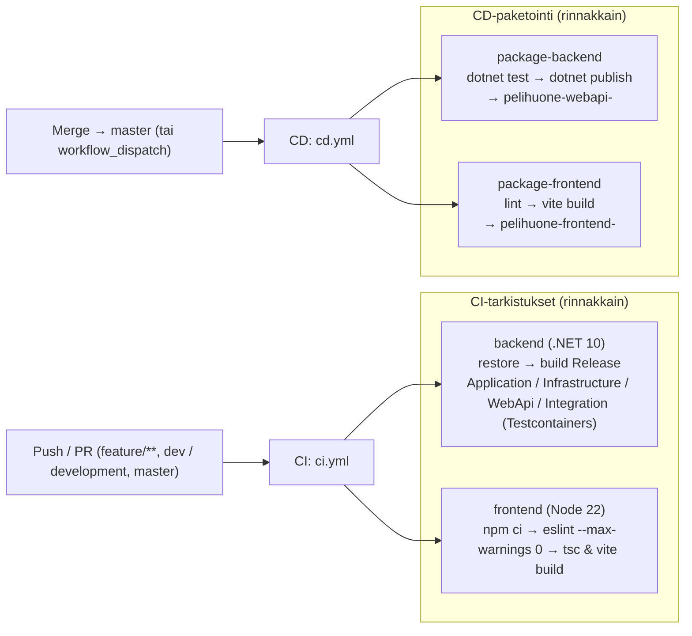

# CI/CD ja GitHub-työnkulut (`.github/`)

Tämä kansio sisältää **Pelihuonevaraus (Xamk Game Room)** -projektin GitHub Actions -automaatiot ja Pull Request -pohjan. Putket pakottavat samat laatupalomuurit kuin [`AGENTS.md`](../AGENTS.md), [`Directory.Build.props`](../Directory.Build.props) ja [`Docs/testaus.md`](../Docs/testaus.md).

---

## Sisältö

| Tiedosto | Tarkoitus |
| :--- | :--- |
| [`workflows/ci.yml`](./workflows/ci.yml) | Jatkuva integraatio (CI): kääntää ja testaa backendin (.NET 10) sekä linttaa ja kääntää frontendin (React 19 + Vite). |
| [`workflows/cd.yml`](./workflows/cd.yml) | Jatkuva toimitus (CD): varmistaa täyden Release-käännöksen ja testit sekä paketoi valmiit julkaisuartefaktit (`webapi` ja `frontend`). |
| [`PULL_REQUEST_TEMPLATE.md`](./PULL_REQUEST_TEMPLATE.md) | [`Docs/versiohallinta.md`](../Docs/versiohallinta.md)-ohjeen mukainen Pull Request -tarkistuslista. |

---

## Putken yleiskuva

---

## 1. CI — Build, Lint & Test (`workflows/ci.yml`)

- **Laukaisimet:**
  - `push` haaroihin `master`, `development`, `dev` ja `feature/**`
  - `pull_request` kohteisiin `master`, `development` ja `dev`
  - `workflow_dispatch` (manuaalinen käynnistys GitHubin Actions-välilehdeltä)
- **Rinnakkaisuus:** `concurrency` peruuttaa saman haaran/PR:n kesken olevat vanhat ajot uuden pushin saapuessa.
- **Oikeudet:** vähimmän oikeuden periaate (`contents: read`).

### `backend`-job (`ubuntu-latest`)
1. Asentaa **.NET 10 SDK**:n (`10.0.x`).
2. Palauttaa riippuvuudet ja kääntää koko ratkaisun (`PelihuoneVaraus.slnx`, `--configuration Release`).
   - Pakottaa [`Directory.Build.props`](../Directory.Build.props)-laatupalomuurin: `TreatWarningsAsErrors`, `IDE0008` (`var`-kielto), `CS1591` (XML-dokumentointi) ja `NuGetAudit`.
3. Ajaa kaikki neljä testiprojektia:
   - `tests/Application.Tests` (Domain- ja Application-yksikkötestit)
   - `tests/Infrastructure.Tests` (EF Core, `OutboxInterceptor`, repositoriot)
   - `tests/WebApi.Tests` (Minimal API -päätepistetestit)
   - `tests/Integration.Tests` (PostgreSQL-rinnakkaisuustestit `Testcontainers.PostgreSql`-kontilla — GitHubin `ubuntu-latest`-runnerissa Docker on valmiiksi käytössä)
4. Virhetilanteessa (`if: failure()`) tallentaa `.trx`-testiraportit artefaktiksi `backend-test-results` (säilytys 7 vrk).

### `frontend`-job (`ubuntu-latest`)
1. Asentaa **Node.js 22**:n ja hyödyntää `npm`-välimuistia (`src/frontend/package-lock.json`).
2. Asentaa lukitut riippuvuudet (`npm --prefix src/frontend ci`).
3. Ajaa ESLint-tarkistuksen (`npm --prefix src/frontend run lint`, `--max-warnings 0`).
4. Kääntää TypeScriptin ja Vite-tuotantopaketin (`npm --prefix src/frontend run build`).

---

## 2. CD — Package Release Artifacts (`workflows/cd.yml`)

- **Laukaisimet:** `push` -> `master` sekä manuaalinen `workflow_dispatch`.
- **Tarkoitus:** Koska lopullista julkaisuympäristöä (esim. Azure App Service, Docker/GHCR tai VPS) ei ole vielä lukittu, CD-putki varmistaa täyden Release-käännöksen sekä kaikki testit ja paketoi valmiit julkaisuartefaktit ladattavaksi GitHub Actionsista (säilytys 30 vrk):
  - `pelihuone-webapi-<commit-sha>` (`dotnet publish src/backend/WebApi/Pelihuone.WebApi.csproj -c Release`)
  - `pelihuone-frontend-<commit-sha>` (`src/frontend/dist`)

### Julkaisuympäristön kytkeminen myöhemmin
Kun kohdeympäristö päätetään:
1. Lisää kohdeympäristön tunnukset GitHubin **Settings → Secrets and variables → Actions** -osioon (älä koskaan tallenna salaisuuksia repoon).
2. Ota käyttöön `workflows/cd.yml`-tiedoston lopussa oleva kommentoitu `deploy`-job (`needs: [package-backend, package-frontend]`, `environment: production`), joka lataa valmiit artefaktit ja julkaisee ne kohdepalveluun.

---

## 3. Suositellut haarasuojaukset GitHubissa

[`Docs/versiohallinta.md`](../Docs/versiohallinta.md)-mallin tukemiseksi suositellaan seuraavia Branch Protection -asetuksia pitkäikäisille haaroille (`master`, `development` / `dev`):
- **Require a pull request before merging** (ei suoria pusheja pitkäikäisiin haaroihin).
- **Require status checks to pass before merging:**
  - `Backend (.NET 10 Build & Tests)`
  - `Frontend (React 19 Lint & Build)`
- **Allow merge commits** (säilyttää askelkohtaisen commit-historian `Docs/versiohallinta.md`:n mukaisesti).
