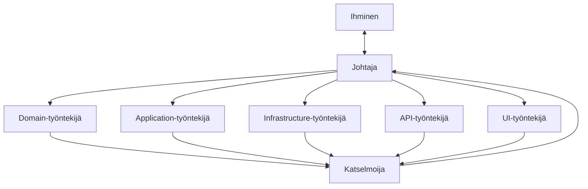

# AGENTS.md — pelihuoneen varausjärjestelmä

Tämä repo on kuvaus ennen koodia. Tämä tiedosto koskee jokaista agenttia roolista riippumatta. Roolikohtaiset rajat ovat `Docs/agentit.md`:ssä.

## Lue tässä järjestyksessä

1. `Docs/domain.md` — kieli, säännöt ja kenen vastuulla kukin sääntö on (`Paikka`-sarake)
2. `Docs/arkkitehtuuri.md` — osat, riippuvuuden suunta, kiellot, elinkaari, ei-tavoitteet, valmis-kriteerit
3. `Docs/rajapinta.md` — reitit, kentät sanoina, statuskoodit, paginaatio
4. `Docs/testaus.md` — testiaineisto, kiinteä kello ajossa, kriteerien ajo, kattavuusmatriisi, kuka ajaa mitäkin
5. `Docs/versiohallinta.md` — haarat, commit, pull request, mitä ei repoon, miten sessio päättyy
6. `Docs/agentit.md` — oma roolisi: mitä luet, mitä saat muuttaa, mitä palautat
7. `Docs/adr/` — tehdyt rakennepäätökset (mm. `0001-tapahtuma-ja-pelipisteet.md`)
8. Se `specs/NNN-*.md`, jota pyydetty muutos koskee, ja vain sen **Tehtävät**-osion pyydetty askel
9. `Docs/tilaus.md` ja `Docs/havainnot.md` — asiakkaan sanat, huoneessa tehdyt havainnot ja oletukset; näihin palataan, kun jokin tuntuu puuttuvan

Työntekijä lukee kohdat 1–8 vain siltä osin kuin `Docs/agentit.md` sen roolille sallii. Johtaja ja katselmoija lukevat kaiken.

## Roolit

- **Johtaja** on ainoa, joka puhuu ihmiselle, tekee git-toimia ja jakaa työtä. Johtaja ei kirjoita koodia itse.
- **Työntekijä** saa yhden Tehtävät-askeleen ja kirjoittaa vain oman kerroksensa projektiin ja sen testiprojektiin (`src/Domain`, `src/Application`, `src/Infrastructure`, `src/WebApi` tai `src/Client`). Se palauttaa muutetut tiedostot, testien tulosteen ja kysymykset johtajalle.
- **Katselmoija** lukee diffin `Docs/domain.md`:n `Paikka`-saraketta, `Docs/arkkitehtuuri.md`:n kieltoja ja specin kriteerejä vasten. Se ei muuta tiedostoja; se palauttaa löytölistan. Tyhjä lista on hyväksyntä.
- Samaan projektiin kirjoittaa kerrallaan yksi työntekijä. Askel, joka koskee kahta kerrosta, jaetaan kahdeksi peräkkäiseksi tehtäväksi.

## Ensin suunnitelma

Ennen kuin yhtään tiedostoa muutetaan, johtaja esittää suunnitelman pyydetylle askeleelle:
1. Mitkä tiedostot luettiin (`AGENTS.md`:n lukujärjestyksessä).
2. Mitkä tiedostot luodaan tai muutetaan.
3. Mikä rooli tekee minkä osan.
4. Missä kerroksessa kukin sääntö tarkistetaan (viittaus `Docs/domain.md`:n riviin).
5. Mitkä testit kirjoitetaan ja miten valmius todetaan.

Johtaja odottaa ihmisen hyväksyntää ennen ensimmäistä tehtävänantoa.

## Älä

- Älä keksi käsitettä, projektia, reittiä, roolia tai haaraa, jota kuvaus ei nimeä.
- Älä aloita tutoriaalista äläkä yleisestä Clean Architecture -pohjasta. Projektit ovat `Docs/arkkitehtuuri.md`:ssä määritellyt osat, ei enempää.
- Älä tee useampaa tehtävälistan askelta yhdellä kertaa, äläkä anna samaa askelta kahdelle työntekijälle.
- Älä kutsu järjestelmän kelloa (`DateTime.Now` / `DateTimeOffset.UtcNow`) suoraan Domainissa tai Applicationissa. Nykyhetki annetaan parametrina tai `IDateTimeProvider`-rajapinnan kautta.
- Älä käytä `var`-avainsanaa C#- tai TypeScript-koodissa (`.editorconfig` ja `Directory.Build.props` pakottavat eksplisiittiset tyypit: `IDE0008 = error`).
- Älä tallenna "vapaana nyt" -tilaa tietokantaan; se on laskettu näkymä aktiivisista varauksista ja kellonajasta.
- Älä muuta `Docs/`- tai `specs/`-tiedostoa työntekijänä. Kuvauksen muutos on johtajan ja ihmisen asia ja oma commit.
- Älä commitoi, pushaa tai yhdistä pull requestia muuna kuin johtajana. Pull requestin yhdistää aina ihminen.

## Pysähdy ja kysy, jos

- säännöllä ei ole `Paikka`-merkintää `Docs/domain.md`:ssä
- spec on ristiriidassa `Docs/`-tiedostojen kanssa
- `Docs/havainnot.md`:n **Avoimet**-kohta koskee tehtävää, jota teet
- joudut valitsemaan statuskoodin, kentän nimen tai kirjaston, jota `Docs/rajapinta.md` tai `Docs/arkkitehtuuri.md` ei mainitse
- askel vaatii kirjoittamista projektiin, johon roolisi ei saa kirjoittaa

Työntekijä kysyy johtajalta, johtaja ihmiseltä. Työntekijä ei arvaa eikä kysy ihmiseltä suoraan. Arvaus näyttää aivan koodilta; kysymys on halvempi.

## Tarkistukset

- **Backend-käännös:** `dotnet build --nologo` repon juuressa (tai kerroskohtaisesti `/nr:false`), `0 Warning(s)`, `0 Error(s)`.
- **Backend-testit:** `dotnet test --nologo` — Domain-testit eivät käynnistä web-palvelinta eivätkä avaa tietokantaa.
- **Frontend-käännös ja linttaus:** `npm --prefix src/Client run build && npm --prefix src/Client run lint` — `0 errors, 0 warnings`.
- **Hyväksymiskriteerit:** specin Given–When–Then-rivit ajetaan HTTP-kutsuina käynnissä olevaa APIa vasten `Docs/testaus.md`:n testiaineistolla ja kellolla. Ihminen ajaa ne; "valmis" ilman ajoa ei kelpaa.

## Definition of Done (sama joka askeleelle)

Askeleen kriteerit ajettu · katselmoija palauttanut tyhjän löytölistan · jokaiselle askeleen säännölle testi · yksi commit per askel, viesti asiakkaan sanoin · ei tietokantatiedostoa, käännöstulosta eikä tokenia repossa · johtajan lopetusviesti `Docs/versiohallinta.md`:n muodossa: haara, commitit, ajettujen tarkistusten tuloste, avoimet kysymykset.

