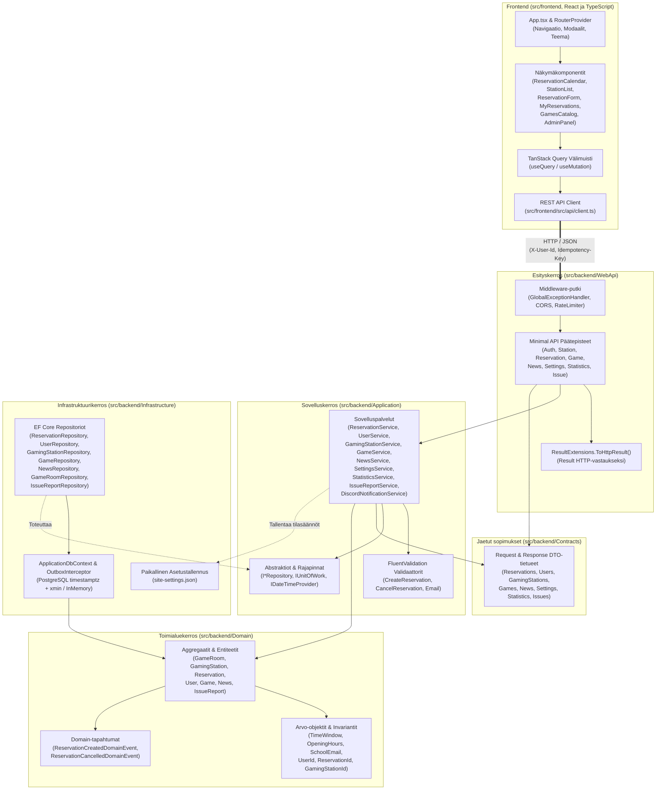
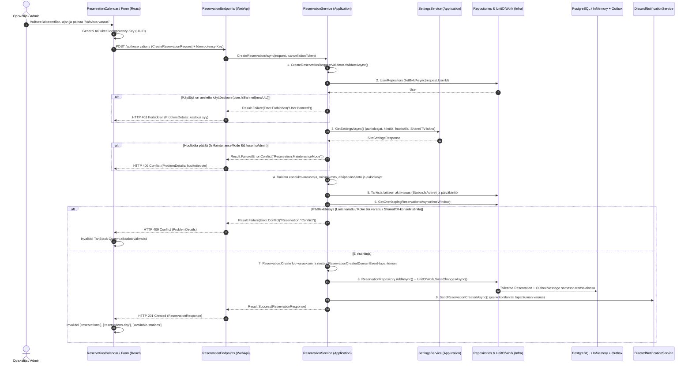
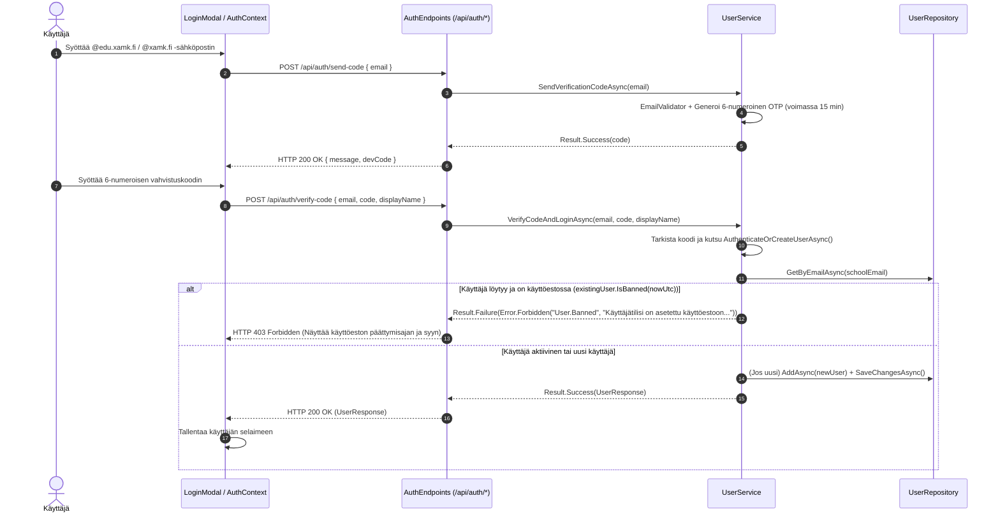
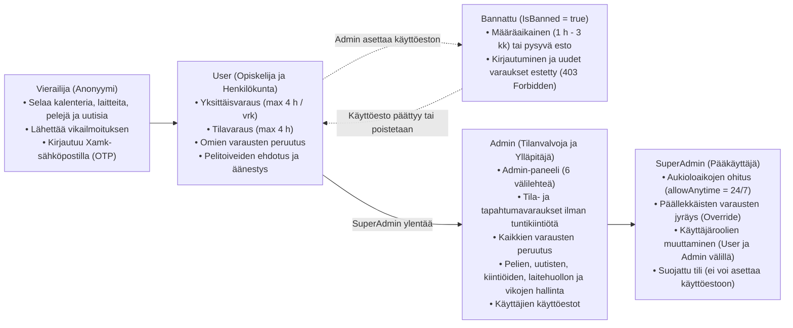
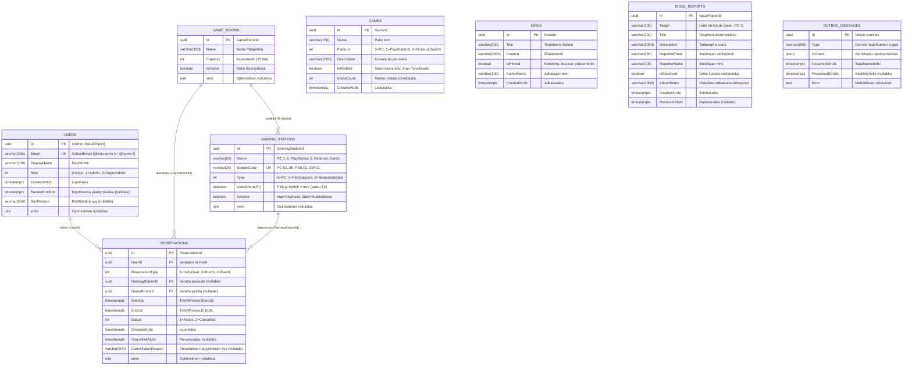
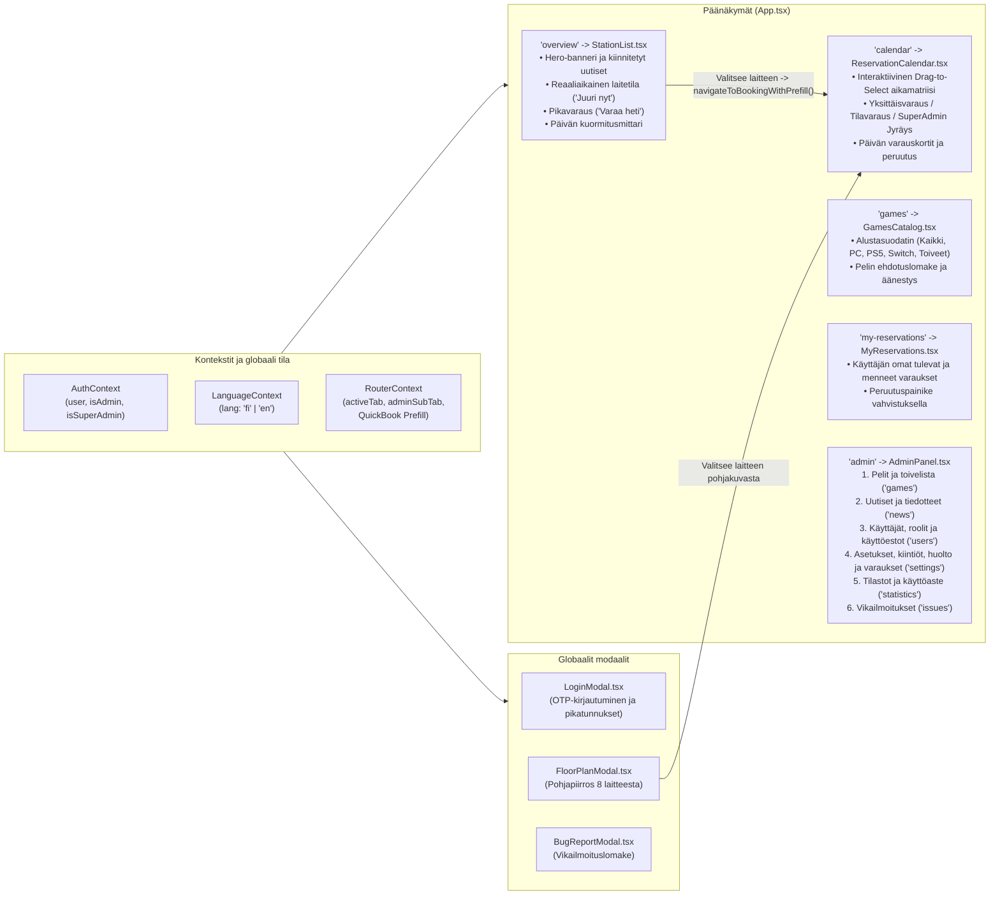

# Full stack -spesifikaatio ja järjestelmän toimintakartta (Xamk Game Room)

Tämä dokumentti kuvaa Pelihuonevaraus (Xamk Game Room) -järjestelmän koko teknologiapinon, kerrosarkkitehtuurin, komponenttien välisen tietovirran, kaikki REST API -kutsut päästä päähän sekä tietomallit.

---

## 1. Full stack -teknologiapino ja laatuvaatimukset

| Osa-alue | Teknologia tai kirjasto | Sijainti projektissa | Rooli ja konfiguraatio |
| :--- | :--- | :--- | :--- |
| **Käyttöliittymä (Frontend)** | React 19 + TypeScript 5.x + Vite | `src/frontend/` | SPA-käyttöliittymä, tiukka tyyppitarkistus (`"strict": true`, `"noImplicitReturns": true`), ei `any`- tai `var`-avainsanoja (`no-var: error`). |
| **Palvelintila ja välimuisti** | TanStack React Query v5 | `src/frontend/src/components/` | Asynkroninen datan haku, automaattinen taustapäivitys (`refetchInterval`) ja välimuistin invalidointi mutaatioiden jälkeen. |
| **Tyylit ja UI-komponentit** | Tailwind CSS + Radix UI / Shadcn | `src/frontend/src/components/ui/` | Xamk Dark Cockpit -teema (`#0B0C10`, `#F5B700`, `#D70E2F`), kosketusystävälliset (min. 44×44 px) ja saavutettavat (WCAG 2.1 AA) komponentit. |
| **HTTP-rajapinta (API)** | ASP.NET Core 10 Minimal APIs | `src/backend/WebApi/` | RESTful JSON API, kiinteän aikaikkunan Rate Limiting (`AuthPolicy`, `ReservationPolicy`), CORS (`AllowClient`) ja RFC 9457 `ProblemDetails`-virheenkäsittely. |
| **Sovelluslogiikka (Application)** | .NET 10 + FluentValidation | `src/backend/Application/` | Käyttötapauspalvelut (`*Service`), syötteiden validointi, `Result<T>`-virheidenkäsittelymalli ja Discord Webhook -ilmoitukset. |
| **Toimialuemalli (Domain)** | Puhdas C# (.NET 10, 0 ulkoista riippuvuutta) | `src/backend/Domain/` | Taktinen DDD: Juurientiteetit (`AggregateRoot`), arvo-objektit (`SchoolEmail`, `TimeWindow`, vahvasti tyypitetyt ID:t) ja domain-tapahtumat (`IDomainEvent`). |
| **Tietokanta ja persistenssi** | EF Core 10 + PostgreSQL (`Npgsql`) / InMemory | `src/backend/Infrastructure/` | `ApplicationDbContext`, optimistinen rivilukitus (`xmin`), `OutboxInterceptor` (Transactional Outbox), automaattinen PostgreSQL ja InMemory -varakäynti ja `DatabaseSeeder`. |
| **Kääntäjäpalomuuri** | MSBuild + Roslyn Analyzers + `.editorconfig` | `Directory.Build.props`, `.editorconfig` | `TreatWarningsAsErrors=true`, `EnforceCodeStyleInBuild=true`, `GenerateDocumentationFile=true` (`CS1591`), eksplisiittiset tyypit pakotettu (`IDE0008 = error`, `var` kielletty). |
| **Testaus (QA)** | xUnit + NSubstitute + Testcontainers | `tests/*` | Yksikkö-, repositorio-, API- ja rinnakkaisvarausten rasitustestit (`Application.Tests`, `Infrastructure.Tests`, `WebApi.Tests`, `Integration.Tests`). |

---

## 2. Arkkitehtuurikartta ja riippuvuuksien suunta (Clean Architecture)

Järjestelmä noudattaa tiukkaa kerrosarkkitehtuuria ja Dependency Inversion -periaatetta. Ulommat kerrokset riippuvat vain sisemmistä kerroksista, eikä `Domain`-kerroksella ole lainkaan ulkoisia pakettiriippuvuuksia.

---

## 3. Kutsujen elinkaari ja sekvenssikaaviot

### 3.1 Varauksen luonti (`POST /api/reservations`)
Kuvaa koko tarkistusketjun aina lomakkeen lähetyksestä huoltotila-, banni-, aukiolo-, kiintiö- ja SharedTV-tarkistuksiin sekä Outbox- ja Discord-viestintään.

### 3.2 Kirjautuminen, OTP-vahvistus ja käyttöeston valvonta
Kuvaa kaksivaiheisen koulusähköpostikirjautumisen (`@edu.xamk.fi` ja `@xamk.fi`) sekä ylläpitäjän asettaman käyttöeston tarkistuksen.

---

## 4. Täydellinen REST API ja kutsukartta

Kaikki backendin päätepisteet on rekisteröity tiedostossa [`Program.cs`](../src/backend/WebApi/Program.cs) ja jaettu toiminnallisiin ryhmiin kansiossa `src/backend/WebApi/Endpoints/`. Ylläpitäjän päätepisteet tarkistavat kutsujan oikeudet `X-User-Id`-otsakkeesta.

### 4.1 Autentikointi ja käyttäjähallinta ([`AuthEndpoints.cs`](../src/backend/WebApi/Endpoints/AuthEndpoints.cs))

| HTTP ja reitti | Suojaus ja Rate Limit | Request DTO | Response DTO | Palvelu ja metodi (`IUserService`) | Kutsutut `api.*`-metodit ja UI-komponentit |
| :--- | :--- | :--- | :--- | :--- | :--- |
| `POST /api/auth/login` | `AuthPolicy` (5/min/IP) | `LoginRequest` | `UserResponse` | `AuthenticateOrCreateUserAsync` | `api.login`, `AuthContext`, `LoginModal` |
| `POST /api/auth/send-code` | `AuthPolicy` (5/min/IP) | `SendVerificationCodeRequest` | `{ message, devCode }` | `SendVerificationCodeAsync` | `LoginModal` (OTP-vaihe 1) |
| `POST /api/auth/verify-code` | `AuthPolicy` (5/min/IP) | `VerifyCodeRequest` | `UserResponse` | `VerifyCodeAndLoginAsync` | `LoginModal` (OTP-vaihe 2) |
| `GET /api/users` | `X-User-Id` (`Admin` ja `SuperAdmin`) | Ei runkoa | `IReadOnlyList<UserResponse>` | `GetAllUsersAsync` | `api.getAllUsers`, `AdminPanel` (`queryKey: ['users']`) |
| `GET /api/users/{id:guid}` | Julkinen tai istunto | Ei runkoa | `UserResponse` | `GetUserByIdAsync` | `api.getUser`, `AuthContext` |
| `PUT /api/users/{id:guid}/role` | `X-User-Id` (`SuperAdmin`) | `UpdateUserRoleRequest` | `UserResponse` | `UpdateUserRoleAsync` | `api.updateUserRole`, `AdminPanel` (Käyttäjät-välilehti) |
| `PUT /api/users/{id:guid}/ban` | `X-User-Id` (`Admin` ja `SuperAdmin`) | `BanUserRequest` | `UserResponse` | `UpdateUserBanAsync` | `api.updateUserBan`, `AdminPanel` (Bannaus ja keston valinta) |

### 4.2 Pelipisteet ja laitetila ([`StationEndpoints.cs`](../src/backend/WebApi/Endpoints/StationEndpoints.cs))

| HTTP ja reitti | Suojaus | Request tai kysely | Response DTO | Palvelu ja metodi (`IGamingStationService`) | Kutsutut `api.*`-metodit ja UI-komponentit |
| :--- | :--- | :--- | :--- | :--- | :--- |
| `GET /api/stations` | Julkinen | Ei parametreja | `IReadOnlyList<GamingStationResponse>` | `GetActiveStationsAsync` | `api.getAllStations`, `App`, `ReservationCalendar`, `StationList` (`['stations']`) |
| `GET /api/stations/admin` | Julkinen tai Admin | Ei parametreja | `IReadOnlyList<GamingStationResponse>` | `GetAllStationsForAdminAsync` | `api.getAllStationsForAdmin`, `AdminPanel` (`['admin-stations']`) |
| `GET /api/stations/available` | Julkinen | `?startUtc=...&endUtc=...` | `IReadOnlyList<GamingStationResponse>` | `GetAvailableStationsAsync` | `api.getAvailableStations`, `StationList`, `ReservationForm`, `FloorPlanModal` (`['available-stations']`, `['available-now']`) |
| `PUT /api/stations/{id:guid}/status` | `X-User-Id` (`Admin` ja `SuperAdmin`) | `UpdateGamingStationStatusRequest` | `GamingStationResponse` | `UpdateStationStatusAsync` | `api.updateStationStatus`, `AdminPanel` (Laitekohtainen huoltotila) |

### 4.3 Varaukset ja pääkäyttäjän jyräys ([`ReservationEndpoints.cs`](../src/backend/WebApi/Endpoints/ReservationEndpoints.cs))

| HTTP ja reitti | Suojaus ja Rate Limit | Request tai kysely | Response DTO | Palvelu ja metodi (`IReservationService`) | Kutsutut `api.*`-metodit ja UI-komponentit |
| :--- | :--- | :--- | :--- | :--- | :--- |
| `POST /api/reservations` | `ReservationPolicy` (10/min/IP) + `Idempotency-Key` | `CreateReservationRequest` | `ReservationResponse` (201) | `CreateReservationAsync` | `api.createReservation`, `ReservationCalendar`, `ReservationForm` |
| `POST /api/reservations/override` | `ReservationPolicy` (10/min/IP) (`SuperAdmin`) | `OverrideReservationRequest` | `ReservationResponse` (201) | `CreateAdminOverrideReservationAsync` | `api.overrideReservation`, `ReservationCalendar`, `ReservationForm` |
| `DELETE /api/reservations/{id:guid}` | Omistaja tai `Admin` ja `SuperAdmin` | `CancelReservationRequest` | `204 No Content` | `CancelReservationAsync` | `api.cancelReservation`, `MyReservations`, `ReservationCalendar`, `AdminPanel` |
| `GET /api/reservations/{id:guid}` | Julkinen | Ei runkoa | `ReservationResponse` | `GetReservationByIdAsync` | `api.getReservation` |
| `GET /api/reservations` | Julkinen | `?startUtc=...&endUtc=...&stationId=...` | `IReadOnlyList<ReservationResponse>` | `GetActiveReservationsAsync` | `api.getActiveReservations`, `ReservationCalendar`, `StationList`, `AdminPanel` (`['reservations']`, `['reservations-day']`, `['admin-reservations']`) |
| `GET /api/users/{userId:guid}/reservations` | Kirjautunut käyttäjä | `?page=1&pageSize=20` | `PagedResult<ReservationResponse>` | `GetUserReservationsAsync` | `api.getUserReservations`, `MyReservations` (`['user-reservations']`) |

### 4.4 Pelivalikoima ja toivelista ([`GameEndpoints.cs`](../src/backend/WebApi/Endpoints/GameEndpoints.cs))

| HTTP ja reitti | Suojaus | Request tai kysely | Response DTO | Palvelu ja metodi (`IGameService`) | Kutsutut `api.*`-metodit ja UI-komponentit |
| :--- | :--- | :--- | :--- | :--- | :--- |
| `GET /api/games` | Julkinen | `?platform=PC&isWishlist=false` | `IReadOnlyList<GameResponse>` | `GetGamesAsync` | `api.getGames`, `GamesCatalog`, `AdminPanel` (`['games']`) |
| `POST /api/games` | `X-User-Id` (`Admin` ja `SuperAdmin`) | `CreateGameRequest` | `GameResponse` (201) | `CreateGameAsync` | `api.createGame`, `AdminPanel` (Pelit-välilehti) |
| `POST /api/games/wishlist` | Kirjautunut käyttäjä | `WishGameRequest` | `GameResponse` (201) | `SuggestGameToWishlistAsync` | `api.wishGame`, `GamesCatalog` (Ehdota peliä) |
| `POST /api/games/{id:guid}/upvote` | Kirjautunut käyttäjä | Ei runkoa | `GameResponse` | `UpvoteWishlistGameAsync` | `api.upvoteGame`, `GamesCatalog` (Äänestä toivetta) |
| `PUT /api/games/{id:guid}/toggle-wishlist` | `X-User-Id` (`Admin` ja `SuperAdmin`) | Ei runkoa | `GameResponse` | `ToggleWishlistStatusAsync` | `api.toggleWishlistStatus`, `AdminPanel` (Hyväksy valikoimaan) |
| `DELETE /api/games/{id:guid}` | `X-User-Id` (`Admin` ja `SuperAdmin`) | Ei runkoa | `204 No Content` | `DeleteGameAsync` | `api.deleteGame`, `AdminPanel` |

### 4.5 Uutiset ja tiedotteet ([`NewsEndpoints.cs`](../src/backend/WebApi/Endpoints/NewsEndpoints.cs))

| HTTP ja reitti | Suojaus | Request DTO | Response DTO | Palvelu ja metodi (`INewsService`) | Kutsutut `api.*`-metodit ja UI-komponentit |
| :--- | :--- | :--- | :--- | :--- | :--- |
| `GET /api/news` | Julkinen | Ei runkoa | `IReadOnlyList<NewsResponse>` | `GetAllNewsAsync` | `api.getNews`, `StationList` (Etusivu ja Hero-banneri), `AdminPanel` (`['news']`) |
| `POST /api/news` | `X-User-Id` (`Admin` ja `SuperAdmin`) | `CreateNewsRequest` | `NewsResponse` (201) | `CreateNewsAsync` | `api.createNews`, `AdminPanel` (Tiedotteet-välilehti) |
| `DELETE /api/news/{id:guid}` | `X-User-Id` (`Admin` ja `SuperAdmin`) | Ei runkoa | `204 No Content` | `DeleteNewsAsync` | `api.deleteNews`, `AdminPanel` |

### 4.6 Sivustoasetukset, varauskiintiöt, tilastot, vikailmoitukset ja terveystarkistukset

| HTTP ja reitti | Tiedosto | Suojaus | Request ja Response DTO | Palvelu ja metodi | Kutsutut `api.*`-metodit ja UI-komponentit |
| :--- | :--- | :--- | :--- | :--- | :--- |
| `GET /api/settings` | `SettingsEndpoints.cs` | Julkinen ja Admin | `SiteSettingsResponse` | `ISettingsService.GetSettingsAsync` | `api.getSettings`, `AdminPanel` (`['settings']`) |
| `PUT /api/settings` | `SettingsEndpoints.cs` | `X-User-Id` (`Admin` ja `SuperAdmin`) | `UpdateSiteSettingsRequest` ja `SiteSettingsResponse` | `ISettingsService.UpdateSettingsAsync` | `api.updateSettings`, `AdminPanel` (Aukioloajat, kiintiöt, huoltotila, Discord) |
| `GET /api/statistics` | `StatisticsEndpoints.cs` | Julkinen ja Admin | `StatisticsResponse` | `IStatisticsService.GetStatisticsAsync` | `api.getStatistics`, `AdminPanel` (`['statistics']`) |
| `POST /api/issues` | `IssueEndpoints.cs` | Julkinen ja Kirjautunut | `CreateIssueReportRequest` ja `IssueReportResponse` (201) | `IIssueReportService.CreateReportAsync` | `api.createIssueReport`, `BugReportModal` |
| `GET /api/issues` | `IssueEndpoints.cs` | `X-User-Id` (`Admin` ja `SuperAdmin`) | `IReadOnlyList<IssueReportResponse>` | `IIssueReportService.GetAllReportsAsync` | `api.getIssueReports`, `AdminPanel` (`['issues']`) |
| `PUT /api/issues/{id:guid}/resolve` | `IssueEndpoints.cs` | `X-User-Id` (`Admin` ja `SuperAdmin`) | `ResolveIssueReportRequest` ja `IssueReportResponse` | `IIssueReportService.ResolveReportAsync` | `api.resolveIssueReport`, `AdminPanel` (Vikailmoitukset-välilehti) |
| `GET /health/live` | `Program.cs` | Julkinen | HTTP 200 (`Healthy`) | ASP.NET Core HealthChecks | Konttiorkestrointi ja valvonta |
| `GET /health/ready` | `Program.cs` | Julkinen | HTTP 200 (`Healthy`) | ASP.NET Core HealthChecks | Konttiorkestrointi ja valvonta |

---

## 5. Roolitukset, käyttöoikeushierarkia ja lupamatriisi (RBAC ja oikeudet)

Järjestelmässä on viisi toiminnallista käyttöoikeustasoa: Vierailija (Anonyymi), Estetty käyttäjä (`Banned`), Peruskäyttäjä (`UserRole.User = 0`), Ylläpitäjä (`UserRole.Admin = 1`) sekä Pääkäyttäjä (`UserRole.SuperAdmin = 2`).

### Täydellinen toiminto- ja lupamatriisi

| Toiminto ja oikeus | Vierailija (Anonyymi) | Bannattu (`IsBanned`) | `User` (Opiskelija) | `Admin` (Ylläpitäjä) | `SuperAdmin` (Pääkäyttäjä) | Valvova kerros |
| :--- | :---: | :---: | :---: | :---: | :---: | :--- |
| **Tilanteen, kalenterin, pelien ja uutisten selaus** | Sallittu | Sallittu | Sallittu | Sallittu | Sallittu | Julkiset `GET`-päätepisteet |
| **Vikailmoituksen lähetys (`POST /api/issues`)** | Sallittu | Sallittu | Sallittu | Sallittu | Sallittu | `IssueEndpoints` |
| **Sisäänkirjautuminen (`@edu.xamk.fi` ja `@xamk.fi`)** | Sallittu | Estetty (`403`) | Sallittu | Sallittu | Sallittu | `UserService.AuthenticateOrCreateUserAsync` |
| **Yksittäisen pelipisteen varaus (`Individual`)** | Estetty | Estetty (`403`) | Sallittu *(max 4 h/vrk)* | Sallittu *(max 4 h/vrk)* | Sallittu *(max 4 h/vrk)* | `ReservationService.CreateReservationAsync` |
| **Koko pelitilan varaus (`Room`)** | Estetty | Estetty (`403`) | Sallittu *(max 4 h)* | Sallittu *(ei tuntirajaa)* | Sallittu *(ei tuntirajaa)* | `ReservationService` (`!user.IsAdmin` kiintiötarkistus) |
| **Tapahtumavaraus (`Event`)** | Estetty | Estetty (`403`) | Estetty (`403`) | Sallittu | Sallittu | `ReservationService` (`!user.IsAdmin` tarkistus) |
| **Varaaminen tilan ollessa huoltotilassa (`IsMaintenanceMode`)** | Estetty | Estetty | Estetty (`409`) | Sallittu | Sallittu | `ReservationService` (`isMaintenanceMode && !user.IsAdmin`) |
| **Varaaminen aukioloaikojen ja arkipäivien ulkopuolella (`24/7`)** | Estetty | Estetty | Estetty (`400`) | Estetty (`400`) | Sallittu (`allowAnytime`) | `OpeningHours.IsWithinOpeningHours(..., allowAnytime: user.IsSuperAdmin)` |
| **Päällekkäisten opiskelijavarausten jyräys (`POST /override`)** | Estetty | Estetty | Estetty (`403`) | Estetty (`403`) | Sallittu | `ReservationService.CreateAdminOverrideReservationAsync` (`user.IsSuperAdmin`) |
| **Oman varauksen peruutus (`DELETE /api/reservations/{id}`)** | Estetty | Estetty | Sallittu | Sallittu | Sallittu | `ReservationService.CancelReservationAsync` |
| **Muiden käyttäjien varausten peruutus** | Estetty | Estetty | Estetty (`403`) | Sallittu | Sallittu | `ReservationService` (`reservation.UserId != userId && !user.IsAdmin`) |
| **Pelitoiveen ehdotus ja äänestys (`Wishlist`)** | Estetty | Estetty | Sallittu | Sallittu | Sallittu | `GamesCatalog.tsx` ja `GameEndpoints` |
| **Pelien lisäys, hyväksyntä valikoimaan ja poisto** | Estetty | Estetty | Estetty (`403`) | Sallittu | Sallittu | `GameEndpoints` (`X-User-Id`: `Admin` tai `SuperAdmin`) |
| **Tiedotteiden julkaisu, kiinnitys ja poisto (`News`)** | Estetty | Estetty | Estetty (`403`) | Sallittu | Sallittu | `NewsEndpoints` (`X-User-Id`: `Admin` tai `SuperAdmin`) |
| **Varauskiintiöiden, aukioloaikojen ja huoltotilan muokkaus** | Estetty | Estetty | Estetty (`403`) | Sallittu | Sallittu | `SettingsEndpoints` (`PUT /api/settings`) |
| **Yksittäisen pelipisteen asettaminen huoltotilaan** | Estetty | Estetty | Estetty (`403`) | Sallittu | Sallittu | `StationEndpoints` (`PUT /api/stations/{id}/status`) |
| **Käyttötilastojen ja vikailmoitusten hallinta** | Estetty | Estetty | Estetty (`403`) | Sallittu | Sallittu | `StatisticsEndpoints` ja `IssueEndpoints` |
| **Käyttäjälistan tarkastelu (`GET /api/users`)** | Estetty | Estetty | Estetty (`403`) | Sallittu | Sallittu | `AuthEndpoints` (`Admin` ja `SuperAdmin`) |
| **Käyttäjän asettaminen käyttöestoon (`PUT /users/{id}/ban`)** | Estetty | Estetty | Estetty (`403`) | Sallittu *(ei SuperAdminia)* | Sallittu *(ei SuperAdminia)* | `AuthEndpoints` + `User.Ban` (`DomainException` jos `IsSuperAdmin`) |
| **Käyttäjän roolin muuttaminen (`PUT /users/{id}/role`)** | Estetty | Estetty | Estetty (`403`) | Estetty (`403`) | Sallittu | `AuthEndpoints` (`authUser.Role == "SuperAdmin"`) |

---

## 6. Tietokantakaavio ja domain-entiteetit (ER-kartta)

Kaikki entiteetit tallennetaan `ApplicationDbContext`-luokan kautta (PostgreSQL-tauluihin tai kehitysympäristön muistitietokantaan) ja jokaisella taululla on oma EF Core -konfiguraationsa kansiossa `src/backend/Infrastructure/Persistence/Configurations/`. Lisäksi järjestelmän dynaamiset aukiolo- ja kiintiösäännöt tallennetaan tiedostoon `site-settings.json`.

---

## 7. Käyttöliittymän komponentti-, reititys- ja välimuistikartta (`src/frontend`)

Käyttöliittymä rakentuu kolmen kontekstintarjoajan (`LanguageProvider`, `AuthProvider`, `RouterProvider`) ja viiden päävälilehden (`NavTab`) ympärille:

### TanStack Query -välimuistiavaimet (`queryKey`) ja niiden synkronointi

| Välimuistiavain (`queryKey`) | Hakeva API-kutsu | Käyttävät komponentit | Mitkä toiminnot (mutaatiot) invalidoivat avaimen? |
| :--- | :--- | :--- | :--- |
| `['stations']` | `api.getAllStations()` | `App`, `StationList`, `ReservationCalendar` | Laitteen tilan vaihto (`updateStationStatusMutation`) |
| `['admin-stations']` | `api.getAllStationsForAdmin()` | `AdminPanel` (`settings`) | Laitteen tilan vaihto (`updateStationStatusMutation`) |
| `['available-stations', start, end]` | `api.getAvailableStations(s, e)` | `ReservationForm`, `FloorPlanModal` | Varauksen luonti, peruutus tai jyräys, asetusten tai laitetilan muutos |
| `['available-now']` | `api.getAvailableStations(now, +30m)` | `StationList` (Etusivun live-tila) | Varauksen luonti, peruutus tai jyräys, asetusten tai laitetilan muutos |
| `['reservations', start, end]` | `api.getActiveReservations(s, e)` | `ReservationCalendar`, `StationList` | Varauksen luonti, peruutus tai SuperAdmin-jyräys |
| `['reservations-day', dayStart, dayEnd]` | `api.getActiveReservations(s, e)` | `ReservationCalendar`, `StationList` | Varauksen luonti, peruutus tai SuperAdmin-jyräys |
| `['admin-reservations']` | `api.getActiveReservations(-2h, +14d)` | `AdminPanel` (`settings`) | Adminin varauksen peruutus (`adminCancelReservationMutation`) |
| `['user-reservations', userId, page]` | `api.getUserReservations(...)` | `MyReservations` | Varauksen luonti tai peruutus |
| `['games']` | `api.getGames()` | `GamesCatalog`, `AdminPanel` | Pelin lisäys, toiveen ehdotus, äänestys, hyväksyntä tai poisto |
| `['news']` | `api.getNews()` | `StationList`, `AdminPanel` | Tiedotteen julkaisu tai poisto |
| `['users']` | `api.getAllUsers(adminId)` | `AdminPanel` (`users`) | Roolin muutos (`updateUserRoleMutation`) tai käyttöesto (`updateUserBanMutation`) |
| `['settings']` | `api.getSettings()` | `AdminPanel` (`settings`) | Asetusten ja varauskiintiöiden tallennus (`updateSettingsMutation`) |
| `['statistics']` | `api.getStatistics()` | `AdminPanel` (`statistics`) | Pelin tilan vaihto, varauksen peruutus ja 10 s automaattipäivitys |
| `['issues']` | `api.getIssueReports(adminId)` | `AdminPanel` (`issues`) | Vikailmoituksen lähetys tai ratkaistuksi kuittaaminen ja 10 s automaattipäivitys |

---

## 8. Automaattinen virhe- ja kaatumishälytysjärjestelmä ylläpidolle

Järjestelmä valvoo taustalla kaikkia HTTP-pyyntöjä ja prosessitason suoritusta:
1. HTTP 500 -palvelinvirheet: [`GlobalExceptionHandler`](../src/backend/WebApi/Middleware/GlobalExceptionHandler.cs) kutsuu skopatusti [`IErrorNotificationService.SendErrorAlertAsync`](../src/backend/Application/Abstractions/Services/IErrorNotificationService.cs) -palvelua. Toimintasäännöistä johtuvat `DomainException`-virheet eivät laukaise hälytyksiä.
2. Prosessitason kaatumiset: [`src/backend/WebApi/Program.cs`](../src/backend/WebApi/Program.cs) ottaa kiinni `AppDomain.CurrentDomain.UnhandledException`-tapahtuman ja lähettää hätähälytyksen ennen prosessin alasajoa.
3. Vastaanottajien dynaaminen haku: osoitteet haetaan tietokannasta kaikille aktiivisille `Admin`- ja `SuperAdmin`-käyttäjille. Jos tietokantayhteys katkeaa kaatumisen yhteydessä, käytetään konfiguroitua varasähköpostia (`Alerts:AdminEmail` tai `Smtp:AdminEmail`).
4. Spämmisuojaus ja cooldown: 60 sekunnin `AlertCooldown` identtisille poikkeuksille estää sähköpostitulvan.
5. SMTP ja simulaatio: [`SmtpEmailSender`](../src/backend/Infrastructure/Services/Email/SmtpEmailSender.cs) lähettää HTML-raportin (sisältäen virheviestin, HTTP-polun, Trace ID:n, isäntäkoneen ja pinojäljen). Kehitysympäristössä ilman SMTP-palvelinta lähetys simuloidaan sovelluslokiin.
