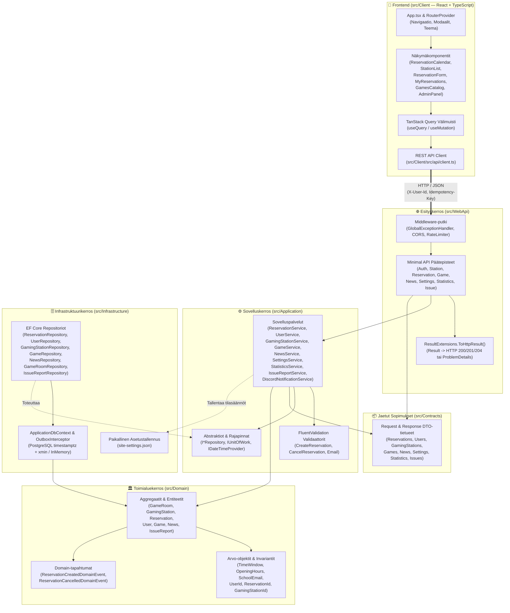
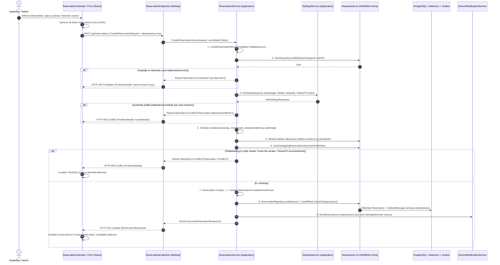
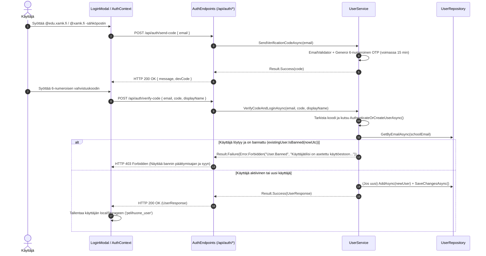
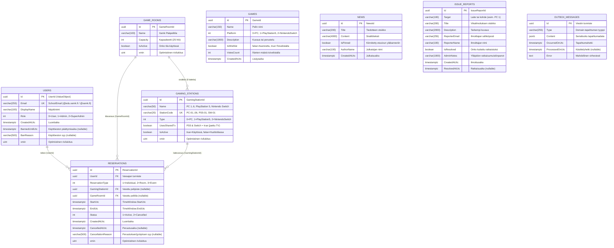
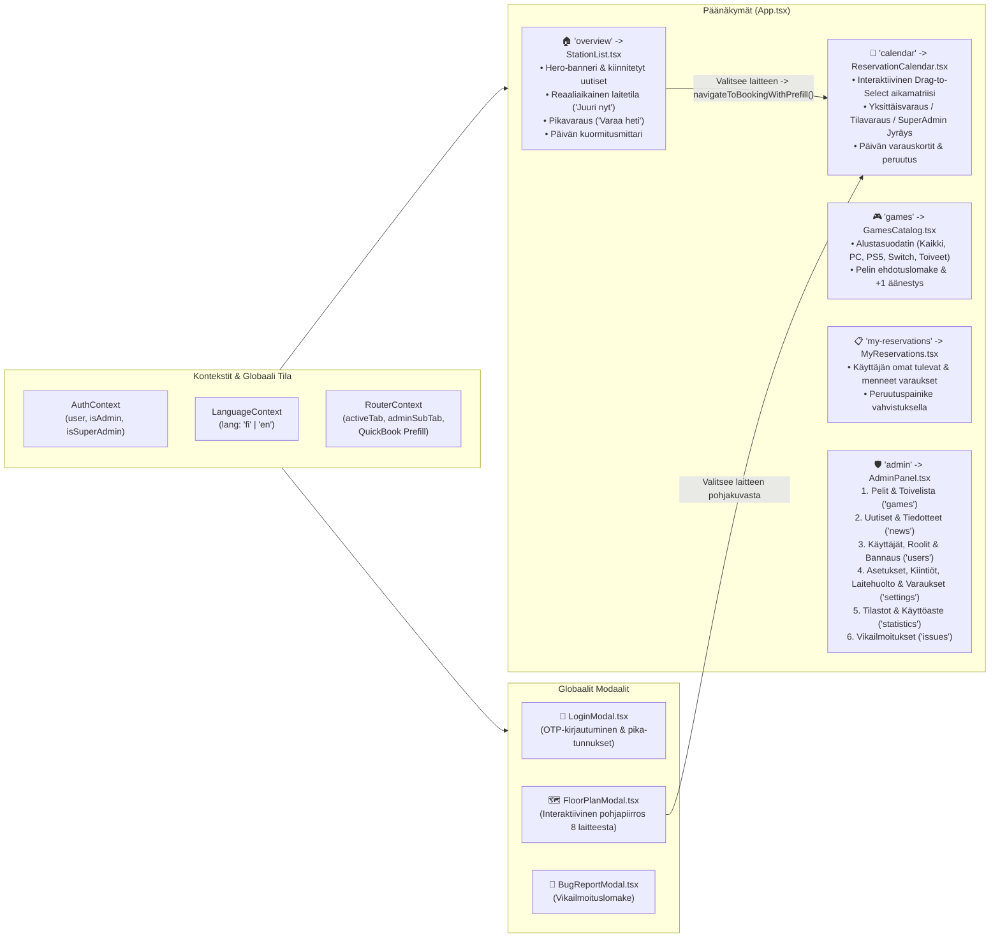

# 🗺️ Full Stack -Spesifikaatio & Järjestelmän Toimintakartta (Xamk Game Room)

Tämä dokumentti kuvaa **Pelihuonevaraus (Xamk Game Room)** -järjestelmän koko teknologiapinon (Full Stack Specs), kerrosarkkitehtuurin, komponenttien välisen tietovirran, kaikki REST API -kutsut päästä päähän (React UI → API Client → Minimal API Endpoint → Application Service → Repository → Tietokanta) sekä tietomallit.

---

## 1. Full Stack -Teknologiapino & Laatuvaatimukset

| Osa-alue | Teknologia / Kirjasto | Sijainti projektissa | Rooli ja konfiguraatio |
| :--- | :--- | :--- | :--- |
| **Käyttöliittymä (Frontend)** | React 19 + TypeScript 5.x + Vite | `src/Client/` | SPA-käyttöliittymä, tiukka tyyppitarkistus (`"strict": true`, `"noImplicitReturns": true`), ei `any`- tai `var`-avainsanoja (`no-var: error`). |
| **Palvelintila & Välimuisti** | TanStack React Query v5 | `src/Client/src/components/` | Asynkroninen datan haku, automaattinen taustapäivitys (`refetchInterval`) ja välimuistin invalidointi mutaatioiden jälkeen. |
| **Tyylit & UI-komponentit** | Tailwind CSS + Radix UI / Shadcn | `src/Client/src/components/ui/` | Xamk Dark Cockpit -teema (`#0B0C10`, `#F5B700`, `#D70E2F`), kosketusystävälliset (min. 44×44 px) ja saavutettavat (WCAG 2.1 AA) komponentit. |
| **HTTP-rajapinta (API)** | ASP.NET Core 10 Minimal APIs | `src/WebApi/` | RESTful JSON API, kiinteän aikaikkunan Rate Limiting (`AuthPolicy`, `ReservationPolicy`), CORS (`AllowClient`) ja RFC 9457 `ProblemDetails`-virheenkäsittely. |
| **Sovelluslogiikka (Application)** | .NET 10 + FluentValidation | `src/Application/` | Käyttötapauspalvelut (`*Service`), syötteiden validointi, `Result<T>`-virheidenkäsittelymalli (ilman poikkeusten heittoa ohjausrakenteena) ja Discord Webhook -ilmoitukset. |
| **Toimialuemalli (Domain)** | puhdas C# (.NET 10, 0 ulkoista riippuvuutta) | `src/Domain/` | Taktinen DDD: Juurientiteetit (`AggregateRoot`), arvo-objektit (`SchoolEmail`, `TimeWindow`, vahvasti tyypitetyt ID:t) ja domain-tapahtumat (`IDomainEvent`). |
| **Tietokanta & Persistenssi** | EF Core 10 + PostgreSQL (`Npgsql`) / InMemory | `src/Infrastructure/` | `ApplicationDbContext`, optimistinen rivilukitus (`xmin`), `OutboxInterceptor` (Transactional Outbox), automaattinen PostgreSQL → InMemory -varakäynti ja `DatabaseSeeder`. |
| **Kääntäjäpalomuuri** | MSBuild + Roslyn Analyzers + `.editorconfig` | `Directory.Build.props`, `.editorconfig` | `TreatWarningsAsErrors=true`, `EnforceCodeStyleInBuild=true`, `GenerateDocumentationFile=true` (`CS1591`), eksplisiittiset tyypit pakotettu (`IDE0008 = error`, `var` kielletty). |
| **Testaus (QA)** | xUnit + NSubstitute + Testcontainers | `tests/*` | Yksikkö-, repositorio-, API- ja rinnakkaisvarausten rasitustestit (`Application.Tests`, `Infrastructure.Tests`, `WebApi.Tests`, `Integration.Tests`). |

---

## 2. Arkkitehtuurikartta & Riippuvuuksien Suunta (Clean Architecture)

Järjestelmä noudattaa tiukkaa kerrosarkkitehtuuria ja Dependency Inversion -periaatetta. Ulommat kerrokset riippuvat vain sisemmistä kerroksista, eikä `Domain`-kerroksella ole lainkaan ulkoisia pakettiriippuvuuksia.

---

## 3. Kutsujen Elinkaari & Sekvenssikaaviot (End-to-End Flows)

### 3.1 Varauksen luonti (`POST /api/reservations`)
Kuvaa koko tarkistusketjun aina lomakkeen lähetyksestä huoltotila-, banni-, aukiolo-, kiintiö- ja SharedTV-tarkistuksiin sekä Outbox- ja Discord-viestintään.

### 3.2 Kirjautuminen, OTP-vahvistus ja Käyttöeston (Bannin) Valvonta
Kuvaa kaksivaiheisen koulusähköpostikirjautumisen (`@edu.xamk.fi` / `@xamk.fi`) sekä adminin asettaman käyttöeston tarkistuksen.

---

## 4. Täydellinen REST API & Kutsukartta (Endpoint-hakemisto)

Kaikki backendin päätepisteet on rekisteröity tiedostossa [`Program.cs`](../src/WebApi/Program.cs) ja jaettu toiminnallisiin ryhmiin kansiossa `src/WebApi/Endpoints/`. Ylläpitäjän päätepisteet tarkistavat kutsujan oikeudet `X-User-Id`-otsakkeesta.

### 4.1 Autentikointi & Käyttäjähallinta ([`AuthEndpoints.cs`](../src/WebApi/Endpoints/AuthEndpoints.cs))

| HTTP & Reitti | Suojaus / Rate Limit | Request DTO | Response DTO | Palvelu & Metodi (`IUserService`) | Kutsutut `api.*`-metodit & UI-komponentit |
| :--- | :--- | :--- | :--- | :--- | :--- |
| `POST /api/auth/login` | `AuthPolicy` (5/min/IP) | `LoginRequest` | `UserResponse` | `AuthenticateOrCreateUserAsync` | `api.login` → `AuthContext`, `LoginModal` |
| `POST /api/auth/send-code` | `AuthPolicy` (5/min/IP) | `SendVerificationCodeRequest` | `{ message, devCode }` | `SendVerificationCodeAsync` | `LoginModal` (OTP-vaihe 1) |
| `POST /api/auth/verify-code` | `AuthPolicy` (5/min/IP) | `VerifyCodeRequest` | `UserResponse` | `VerifyCodeAndLoginAsync` | `LoginModal` (OTP-vaihe 2) |
| `GET /api/users` | `X-User-Id` (`Admin` / `SuperAdmin`) | — | `IReadOnlyList<UserResponse>` | `GetAllUsersAsync` | `api.getAllUsers` → `AdminPanel` (`queryKey: ['users']`) |
| `GET /api/users/{id:guid}` | Julkinen / Istunto | — | `UserResponse` | `GetUserByIdAsync` | `api.getUser` → `AuthContext` |
| `PUT /api/users/{id:guid}/role` | `X-User-Id` (`SuperAdmin`) | `UpdateUserRoleRequest` | `UserResponse` | `UpdateUserRoleAsync` | `api.updateUserRole` → `AdminPanel` (Käyttäjät-välilehti) |
| `PUT /api/users/{id:guid}/ban` | `X-User-Id` (`Admin` / `SuperAdmin`) | `BanUserRequest` | `UserResponse` | `UpdateUserBanAsync` | `api.updateUserBan` → `AdminPanel` (Bannaus & keston valinta) |

### 4.2 Pelipisteet & Laitetila ([`StationEndpoints.cs`](../src/WebApi/Endpoints/StationEndpoints.cs))

| HTTP & Reitti | Suojaus | Request / Query | Response DTO | Palvelu & Metodi (`IGamingStationService`) | Kutsutut `api.*`-metodit & UI-komponentit |
| :--- | :--- | :--- | :--- | :--- | :--- |
| `GET /api/stations` | Julkinen | — | `IReadOnlyList<GamingStationResponse>` | `GetActiveStationsAsync` | `api.getAllStations` → `App`, `ReservationCalendar`, `StationList` (`['stations']`) |
| `GET /api/stations/admin` | Julkinen / Admin | — | `IReadOnlyList<GamingStationResponse>` | `GetAllStationsForAdminAsync` | `api.getAllStationsForAdmin` → `AdminPanel` (`['admin-stations']`) |
| `GET /api/stations/available` | Julkinen | `?startUtc=...&endUtc=...` | `IReadOnlyList<GamingStationResponse>` | `GetAvailableStationsAsync` | `api.getAvailableStations` → `StationList`, `ReservationForm`, `FloorPlanModal` (`['available-stations']`, `['available-now']`) |
| `PUT /api/stations/{id:guid}/status` | `X-User-Id` (`Admin` / `SuperAdmin`) | `UpdateGamingStationStatusRequest` | `GamingStationResponse` | `UpdateStationStatusAsync` | `api.updateStationStatus` → `AdminPanel` (Laitekohtainen huoltotila) |

### 4.3 Varaukset & SuperAdmin-jyräys ([`ReservationEndpoints.cs`](../src/WebApi/Endpoints/ReservationEndpoints.cs))

| HTTP & Reitti | Suojaus / Rate Limit | Request / Query | Response DTO | Palvelu & Metodi (`IReservationService`) | Kutsutut `api.*`-metodit & UI-komponentit |
| :--- | :--- | :--- | :--- | :--- | :--- |
| `POST /api/reservations` | `ReservationPolicy` (10/min/IP) + `Idempotency-Key` | `CreateReservationRequest` | `ReservationResponse` (201) | `CreateReservationAsync` | `api.createReservation` → `ReservationCalendar`, `ReservationForm` |
| `POST /api/reservations/override` | `ReservationPolicy` (10/min/IP) (`SuperAdmin`) | `OverrideReservationRequest` | `ReservationResponse` (201) | `CreateAdminOverrideReservationAsync` | `api.overrideReservation` → `ReservationCalendar`, `ReservationForm` |
| `DELETE /api/reservations/{id:guid}` | Omistaja tai `Admin`/`SuperAdmin` | `CancelReservationRequest` | `204 No Content` | `CancelReservationAsync` | `api.cancelReservation` → `MyReservations`, `ReservationCalendar`, `AdminPanel` |
| `GET /api/reservations/{id:guid}` | Julkinen | — | `ReservationResponse` | `GetReservationByIdAsync` | `api.getReservation` |
| `GET /api/reservations` | Julkinen | `?startUtc=...&endUtc=...&stationId=...` | `IReadOnlyList<ReservationResponse>` | `GetActiveReservationsAsync` | `api.getActiveReservations` → `ReservationCalendar`, `StationList`, `AdminPanel` (`['reservations']`, `['reservations-day']`, `['admin-reservations']`) |
| `GET /api/users/{userId:guid}/reservations` | Kirjautunut käyttäjä | `?page=1&pageSize=20` | `PagedResult<ReservationResponse>` | `GetUserReservationsAsync` | `api.getUserReservations` → `MyReservations` (`['user-reservations']`) |

### 4.4 Pelivalikoima & Toivelista ([`GameEndpoints.cs`](../src/WebApi/Endpoints/GameEndpoints.cs))

| HTTP & Reitti | Suojaus | Request / Query | Response DTO | Palvelu & Metodi (`IGameService`) | Kutsutut `api.*`-metodit & UI-komponentit |
| :--- | :--- | :--- | :--- | :--- | :--- |
| `GET /api/games` | Julkinen | `?platform=PC&isWishlist=false` | `IReadOnlyList<GameResponse>` | `GetGamesAsync` | `api.getGames` → `GamesCatalog`, `AdminPanel` (`['games']`) |
| `POST /api/games` | `X-User-Id` (`Admin` / `SuperAdmin`) | `CreateGameRequest` | `GameResponse` (201) | `CreateGameAsync` | `api.createGame` → `AdminPanel` (Pelit-välilehti) |
| `POST /api/games/wishlist` | Kirjautunut käyttäjä | `WishGameRequest` | `GameResponse` (201) | `SuggestGameToWishlistAsync` | `api.wishGame` → `GamesCatalog` (Ehdota peliä) |
| `POST /api/games/{id:guid}/upvote` | Kirjautunut käyttäjä | — | `GameResponse` | `UpvoteWishlistGameAsync` | `api.upvoteGame` → `GamesCatalog` (Äänestä toivetta) |
| `PUT /api/games/{id:guid}/toggle-wishlist` | `X-User-Id` (`Admin` / `SuperAdmin`) | — | `GameResponse` | `ToggleWishlistStatusAsync` | `api.toggleWishlistStatus` → `AdminPanel` (Hyväksy valikoimaan) |
| `DELETE /api/games/{id:guid}` | `X-User-Id` (`Admin` / `SuperAdmin`) | — | `204 No Content` | `DeleteGameAsync` | `api.deleteGame` → `AdminPanel` |

### 4.5 Uutiset & Tiedotteet ([`NewsEndpoints.cs`](../src/WebApi/Endpoints/NewsEndpoints.cs))

| HTTP & Reitti | Suojaus | Request DTO | Response DTO | Palvelu & Metodi (`INewsService`) | Kutsutut `api.*`-metodit & UI-komponentit |
| :--- | :--- | :--- | :--- | :--- | :--- |
| `GET /api/news` | Julkinen | — | `IReadOnlyList<NewsResponse>` | `GetAllNewsAsync` | `api.getNews` → `StationList` (Etusivu & Hero-banneri), `AdminPanel` (`['news']`) |
| `POST /api/news` | `X-User-Id` (`Admin` / `SuperAdmin`) | `CreateNewsRequest` | `NewsResponse` (201) | `CreateNewsAsync` | `api.createNews` → `AdminPanel` (Tiedotteet-välilehti) |
| `DELETE /api/news/{id:guid}` | `X-User-Id` (`Admin` / `SuperAdmin`) | — | `204 No Content` | `DeleteNewsAsync` | `api.deleteNews` → `AdminPanel` |

### 4.6 Sivustoasetukset, Varauskiintiöt, Tilastot, Vikailmoitukset & Terveystarkistukset

| HTTP & Reitti | Tiedosto | Suojaus | Request / Response DTO | Palvelu & Metodi | Kutsutut `api.*`-metodit & UI-komponentit |
| :--- | :--- | :--- | :--- | :--- | :--- |
| `GET /api/settings` | `SettingsEndpoints.cs` | Julkinen / Admin | `SiteSettingsResponse` | `ISettingsService.GetSettingsAsync` | `api.getSettings` → `AdminPanel` (`['settings']`) |
| `PUT /api/settings` | `SettingsEndpoints.cs` | `X-User-Id` (`Admin` / `SuperAdmin`) | `UpdateSiteSettingsRequest` → `SiteSettingsResponse` | `ISettingsService.UpdateSettingsAsync` | `api.updateSettings` → `AdminPanel` (Aukioloajat, kiintiöt, huoltotila, Discord) |
| `GET /api/statistics` | `StatisticsEndpoints.cs` | Julkinen / Admin | `StatisticsResponse` | `IStatisticsService.GetStatisticsAsync` | `api.getStatistics` → `AdminPanel` (`['statistics']`) |
| `POST /api/issues` | `IssueEndpoints.cs` | Julkinen / Kirjautunut | `CreateIssueReportRequest` → `IssueReportResponse` (201) | `IIssueReportService.CreateReportAsync` | `api.createIssueReport` → `BugReportModal` |
| `GET /api/issues` | `IssueEndpoints.cs` | `X-User-Id` (`Admin` / `SuperAdmin`) | `IReadOnlyList<IssueReportResponse>` | `IIssueReportService.GetAllReportsAsync` | `api.getIssueReports` → `AdminPanel` (`['issues']`) |
| `PUT /api/issues/{id:guid}/resolve` | `IssueEndpoints.cs` | `X-User-Id` (`Admin` / `SuperAdmin`) | `ResolveIssueReportRequest` → `IssueReportResponse` | `IIssueReportService.ResolveReportAsync` | `api.resolveIssueReport` → `AdminPanel` (Vikailmoitukset-välilehti) |
| `GET /health/live` | `Program.cs` | Julkinen | HTTP 200 (`Healthy`) | ASP.NET Core HealthChecks | Konttiorkestrointi / Valvonta |
| `GET /health/ready` | `Program.cs` | Julkinen | HTTP 200 (`Healthy`) | ASP.NET Core HealthChecks | Konttiorkestrointi / Valvonta |

---

## 5. Tietokantakaavio & Domain-entiteetit (ER-kartta)

Kaikki entiteetit tallennetaan `ApplicationDbContext`-luokan kautta (PostgreSQL-tauluihin tai kehitysympäristön muistitietokantaan) ja jokaisella taululla on oma EF Core -konfiguraationsa kansiossa `src/Infrastructure/Persistence/Configurations/`. Lisäksi järjestelmän dynaamiset aukiolo- ja kiintiösäännöt tallennetaan tiedostoon `site-settings.json`.

---

## 6. Käyttöliittymän Komponentti-, Reititys- ja Välimuistikartta (`src/Client`)

Käyttöliittymä rakentuu kolmen kontekstintarjoajan (`LanguageProvider`, `AuthProvider`, `RouterProvider`) ja viiden päävälilehden (`NavTab`) ympärille:

### TanStack Query -välimuistiavaimet (`queryKey`) ja niiden synkronointi

| Välimuistiavain (`queryKey`) | Hakeva API-kutsu | Käyttävät komponentit | Mitkä toiminnot (mutaatiot) invalidoivat avaimen? |
| :--- | :--- | :--- | :--- |
| `['stations']` | `api.getAllStations()` | `App`, `StationList`, `ReservationCalendar` | Laitteen tilan vaihto (`updateStationStatusMutation`) |
| `['admin-stations']` | `api.getAllStationsForAdmin()` | `AdminPanel` (`settings`) | Laitteen tilan vaihto (`updateStationStatusMutation`) |
| `['available-stations', start, end]` | `api.getAvailableStations(s, e)` | `ReservationForm`, `FloorPlanModal` | Varauksen luonti/peruutus/jyräys, asetusten tai laitetilan muutos |
| `['available-now']` | `api.getAvailableStations(now, +30m)` | `StationList` (Etusivun live-tila) | Varauksen luonti/peruutus/jyräys, asetusten tai laitetilan muutos |
| `['reservations', start, end]` | `api.getActiveReservations(s, e)` | `ReservationCalendar`, `StationList` | Varauksen luonti, peruutus tai SuperAdmin-jyräys |
| `['reservations-day', dayStart, dayEnd]` | `api.getActiveReservations(s, e)` | `ReservationCalendar`, `StationList` | Varauksen luonti, peruutus tai SuperAdmin-jyräys |
| `['admin-reservations']` | `api.getActiveReservations(-2h, +14d)` | `AdminPanel` (`settings`) | Adminin varauksen peruutus (`adminCancelReservationMutation`) |
| `['user-reservations', userId, page]` | `api.getUserReservations(...)` | `MyReservations` | Varauksen luonti tai peruutus |
| `['games']` | `api.getGames()` | `GamesCatalog`, `AdminPanel` | Pelin lisäys, toiveen ehdotus, äänestys, hyväksyntä tai poisto |
| `['news']` | `api.getNews()` | `StationList`, `AdminPanel` | Tiedotteen julkaisu tai poisto |
| `['users']` | `api.getAllUsers(adminId)` | `AdminPanel` (`users`) | Roolin muutos (`updateUserRoleMutation`) tai bannaus (`updateUserBanMutation`) |
| `['settings']` | `api.getSettings()` | `AdminPanel` (`settings`) | Asetusten ja varauskiintiöiden tallennus (`updateSettingsMutation`) |
| `['statistics']` | `api.getStatistics()` | `AdminPanel` (`statistics`) | Pelin tilan vaihto, varauksen peruutus + 10 s automaattipäivitys |
| `['issues']` | `api.getIssueReports(adminId)` | `AdminPanel` (`issues`) | Vikailmoituksen lähetys tai ratkaistuksi kuittaaminen + 10 s automaattipäivitys |
