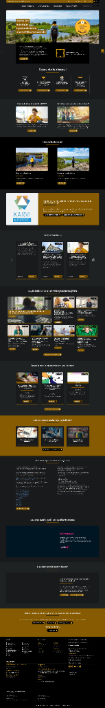

# UI ja visuaalinen spesifikaatio, Xamk Game Room (Pelihuonevaraus)

Spec-Driven Development (SDD) -määrittely ja **Dark Neo-Brutalism** -designjärjestelmä käyttöliittymälle (`src/frontend/**`). Tämä dokumentti määrittelee mitä käyttöliittymässä rakennetaan, miksi jokainen rakenne ja sääntö on olemassa, sekä miten [`Docs/domain.md`](./domain.md) ja [Xamkin brändiohjeisto](https://www.xamk.fi/en/xamk-brand-guidelines/) ohjaavat toteutusta.

---

## 1. Miksi tämä käyttöliittymä rakennetaan

Kaakkois-Suomen ammattikorkeakoulun (Xamk) pelihuoneessa on rajallinen määrä laitteita (6 kpl PC-pelipisteitä sekä PlayStation 5 ja Nintendo Switch, jotka jakavat yhteisen 4K-television). Ilman selkeää, reaaliaikaista ja säännöt pakottavaa käyttöliittymää syntyy kolme ongelmaa:

1. Tuplavaraukset ja SharedTV-ristiriidat: Opiskelijat varaavat PS5:n ja Switchin samaan aikaan tietämättä, että molemmat konsolit käyttävät samaa fyysistä televisiota.
2. Epäselvä tilannekuva: Kampukselle saapuva opiskelija ei tiedä, onko pelitila vapaana, varattuna yksittäisille pelaajille vai suljettuna turnauksen tai tapahtuman vuoksi.
3. Hajautunut ylläpito: Opettajilla (`SuperAdmin`) ja opiskelijaylläpitäjillä (`Admin`) ei ole yhtenäistä hallintapaneelia laiterikkojen, pelitoiveiden, tiedotteiden ja poikkeusvarausten (override) hoitamiseen.

SDD-periaate käyttöliittymässä: Käyttöliittymä on domain-invarianttien visuaalinen ohjauskerros. Jokainen komponentti pyrkii estämään virheellisen tilan syntymisen ennen palvelinkutsua ja heijastaa palvelimen palauttamat tilat (`409 Conflict`, `ProblemDetails`) välittömästi käyttäjälle.

---

## 2. Ehdottomat perussäännöt

1. Nollatoleranssi toiminnallisille regressioille: visuaalinen tai tyylillinen muutos ei saa rikkoa olemassa olevaa sovelluslogiikkaa, tapahtumakäsittelijöitä tai tiloja.
2. Ei sarjakuvaemojeja: kaikki symbolit toteutetaan johdonmukaisesti Lucide React -vektori-ikoneilla (`lucide-react`) ja virallisilla brändi-ikoneilla (`DiscordIcon`).
3. Korkearesoluutioiset grafiikka- ja brändiasetit: logot ja kuvat toimitetaan vektoreina tai korkearesoluutioisina valokuvina ilman sumeita rasterileikkauksia.
4. Monikielisyys: kaikki tekstit haetaan `useLanguage()`-hookin kautta (`LanguageContext.tsx`) tai kielivalinnalla (`fi` / `en`) molemmille kielille.
5. Laitteiden nimeämisstandardi: tietokoneet "PC 1" - "PC 6", konsolit "PlayStation 5" ja "Nintendo Switch".
6. Alapalkin organisaatiotiedot: alapalkissa käytetään aina virallista oppilaitos- ja tilatunnusta: Kaakkois-Suomen ammattikorkeakoulu, Xamk Game Room sekä kampukset Kotka, Kouvola, Mikkeli ja Savonlinna.

---

## 3. Sanasto: toimialuemallin ja käyttöliittymän kytkennät

Sama termi tiedostossa [`Docs/domain.md`](./domain.md), API-sopimuksessa ja React-komponenteissa:

| Domain-käsite | UI-komponentti / Näkymä | Mitä rakennetaan | Miksi juuri näin |
| :--- | :--- | :--- | :--- |
| **GameRoom** | [`FloorPlanModal.tsx`](../src/frontend/src/components/FloorPlanModal.tsx), [`RealtimeStatus.tsx`](../src/frontend/src/components/RealtimeStatus.tsx) | Interaktiivinen pohjapiirros ja reaaliaikainen tilannekuva koko huoneesta. | Käyttäjä hahmottaa fyysisen tilan (PC 1-6, PS5, Switch ja yhteinen TV) yhdellä silmäyksellä ennen varausta. |
| **GamingStation** | 8 laitteen aikataulumatriisi ([`BookingCalendar.tsx`](../src/frontend/src/components/BookingCalendar.tsx)) | Kaikkien 8 pelipisteen rinnakkainen 30 minuutin aikataulumatriisi (`Nintendo Switch`, `PC 1`–`PC 6`, `PlayStation 5`) ilman erillisiä päällekkäisiä pelipistekortteja matriisin alla. | Mahdollistaa vapaan laitteen ja 30 min–4 h aikavälin valinnan yhdellä vedolla tai napautuksella sekä työpöydällä että kosketusnäytöllä. |
| **Reservation** | [`BookingCalendar.tsx`](../src/frontend/src/components/BookingCalendar.tsx), [`MyReservations.tsx`](../src/frontend/src/components/MyReservations.tsx) | Varauslomake (`laite`, `koko tila` tai `tapahtuma`), omien varausten hallinta, tulevan varauksen peruutus (Sääntö #5), käynnissä olevan varauksen kesken lopettaminen (**Lopeta varaus**, Spec 004 / Sääntö #12) sekä mobiiliystävällinen paluupainike **Takaisin: Varaa laite**. | Erottaa yksittäisen opiskelijavarauksen (30 min–4 h) ja koko tilan varauksen, estää jo alkaneen varauksen perumisen ja vapauttaa laitteen heti kesken lopetettaessa. |
| **SharedTV** | Konsolien ristiriitatunnistin ([`BookingCalendar.tsx`](../src/frontend/src/components/BookingCalendar.tsx)) | Visuaalinen varattu-tila ja lukitus 30 min tarkkuudella, kun PS5 tai Switch on varattuna valitulle aikavälille. | Tekee Domain-säännön #8 (*PS5 ja Switch jakavat saman TV:n*) näkyväksi laitetta valittaessa. |
| **OpeningHours** | Aikaslottien suodatus (`08:00-18:00`) | Kellonaikavalitsimet (`Alkamisaika` ja `Päättymisaika` rinnakkain 30 min askelein) ja 20 puolen tunnin solun aikamatriisi klo 08:00–18:00. | Estää virheelliset varausyritykset aukioloaikojen ulkopuolelle (Sääntö #2) ja tukee 30 min vähimmäiskestoa (Sääntö #3), paitsi `SuperAdmin`-tilassa. |
| **User / Guest** | [`LandingPage.tsx`](../src/frontend/src/components/LandingPage.tsx), [`LoginModal.tsx`](../src/frontend/src/components/LoginModal.tsx) | Kirjautumaton laskeutumissivu sekä 2-vaiheinen `@edu.xamk.fi` ja `@xamk.fi` -vahvistuskoodikirjautuminen. | Suojaa varauskalenterin ja käyttäjälistat kirjautumattomilta käyttäjiltä säilyttäen tiedotteet, aukioloajat, pohjakuvan ja säännöt julkisina. |
| **Admin** | [`AdminPanel.tsx`](../src/frontend/src/components/AdminPanel.tsx), `src/frontend/src/components/admin/*` (`/admin`, `/admin/*`) | Dedikoitu neo-brutalistinen Admin Shell: kokoon taitettava sivupalkki (mobiilissa hampurilaisvalikko/drawer), yleiskatsaus-hubi toimintokorteilla (ilman yläosan 4 KPI-kortin riviä), modaalipohjaiset lomakkeet sekä **Sivuston asetukset**. | Keskittää päivittäisen ylläpidon (Varaukset, Pelipisteet ja huolto, Vikailmoitukset, Pelit, Tiedotteet, Käyttäjät, Tilastot, Sivuston asetukset) selkeään työpöytä- ja mobiilinäkymään. |
| **SuperAdmin** | [`SuperAdminPanel.tsx`](../src/frontend/src/components/SuperAdminPanel.tsx) (`/superadmin`, `/admin/override`) | **Tapahtumavaraukset**: pääkäyttäjän viralliset tapahtumavaraukset (`override`), päällekkäisten varausten automaattinen peruutus ja roolien hallinta saman `AdminLayout`-kehyksen sisällä. | Mahdollistaa opettajille tapahtumien ja turnausten luomisen aukioloajoista riippumatta (Sääntö #10). |

---

## 4. Visuaalinen Dark Neo-Brutalism -designjärjestelmä ja Xamk-brändi

Käyttöliittymä noudattaa **Dark Neo-Brutalism** -tyylijärjestelmää, joka yhdistää Xamkin keltaisen brändiaksentin teräviin `0px`-kulmiin (`rounded-none`), vahvoihin mustiin/grafiitinvärisiin kehyksiin, koviin offset-varjoihin (`shadow-[4px_4px_0px_#000000]`, `shadow-[5px_5px_0px_#FACC15]`) sekä tekniseen typografiaan:

```text
┌──────────────────────────────────────────────────────────────┐
│ Taso 1: Tumma perustausta (AppShell, Navbar, Main)           │  #121417
│ ┌──────────────────────────────────────────────────────────┐ │
│ │ Taso 2: Korotetut kortit, Aikamatriisi, Footer           │ │  #1C1F24 / border #3F444E
│ │ ┌──────────────────────┐    ┌──────────────────────────┐ │ │
│ │ │ Korkean kontrastin   │    │ Tumma aikataulumatriisi  │ │ │  #FFFFFF (lomake) / #1C1F24 (matriisi)
│ │ │ varauslomake         │    │ (20 × 30 min solut)      │ │ │
│ │ └──────────────────────┘    └──────────────────────────┘ │ │
│ └──────────────────────────────────────────────────────────┘ │
└──────────────────────────────────────────────────────────────┘
```

### 4.0 Päänäkymän rakenne ja komponentit

#### Referenssikuva 1: Päänäkymän rakenne


| Alue | Mitä rakennetaan | Vastaava toteutus koodissa |
| :--- | :--- | :--- |
| **1. Kaksirivinen yläpalkki (`#121417` / `#1C1F24`)** | Työpöydällä 2-rivinen rakenne, jotta logo (`PELIHUONEVARAUS`), kaikki välilehdet, `Admin` split-painike (suora siirtymä + alasvetovalikko), vikailmoitus, kielenvaihtaja ja profiili näkyvät kokonaan; mobiilissa kompakti ylärivi ja hampurilaisvalikko. | [`Navbar.tsx`](../src/frontend/src/components/Navbar.tsx) |
| **2. Hero-banneri ja infolaatikko** | Yhdenmukaistettu Xamk X -logo, kultainen otsikkolaatikko (`TERVETULOA XAMK GAME ROOMIIN`) ja tumma infolaatikko aukioloajoilla sekä kiinnitetyllä tiedotteella. | [`NewsBanner.tsx`](../src/frontend/src/components/NewsBanner.tsx), [`LandingPage.tsx`](../src/frontend/src/components/LandingPage.tsx) |
| **3. Responsiivinen varausnäkymä (`#121417`)** | Työpöydällä (`lg:`) kaksipalstainen: vasemmalla korkean kontrastin valkoinen varauslomake (`Alkamisaika` ja `Päättymisaika` rinnakkain 30 min välein), oikealla 20 × 30 min aikataulumatriisi. Mobiilissa (`< lg`) aikataulumatriisi + kompaktit varaustyyppi- ja päivämäärävalitsimet ylimpänä sekä kiinteä alavahvistuspalkki (`fixed bottom-0`). | [`BookingCalendar.tsx`](../src/frontend/src/components/BookingCalendar.tsx), `src/frontend/src/components/ui/*` |
| **4. 4-sarakkeinen alapalkki kultaviivalla** | Koko leveyden keltainen erotinviiva (`#FACC15`), 4 saraketta (*Pelihuone*, *Ohjeet ja tila*, *Yhteisö ja tuki* + `DiscordIcon`, *Käyttäjä & Xamk-organisaatiotiedot*) sekä tekijänoikeuspalkki. | [`App.tsx`](../src/frontend/src/App.tsx), [`LandingPage.tsx`](../src/frontend/src/components/LandingPage.tsx) |

#### Referenssikuva 2: Xamk.fi, brändin rytmi ja kortit


### 4.1 Väritokenit, typografia ja tyylit (`src/frontend/src/index.css`, `index.html`)
- **Tailwind CSS v4 `@theme` -paletti:**
  - Tummat pinnat: `#121417` (päätausta / `<body>` estämään valkoisen välähdyksen), `#1C1F24` (kortit ja paneelit), `#3F444E` (reunaviivat), `#09090B` / `#000000` (mustat kehykset, varjot ja teksti keltaisella/valkoisella).
  - Korkean kontrastin lomakepinta: `#FFFFFF` (varauslomake) ja `#F4F4F5` (pääteksti tummalla, `#A1A1AA` toissijainen teksti).
  - Xamk Keltainen / Kulta: `#FACC15` (ensi­sijaiset toimintopainikkeet, aktiiviset solut, erotinviivat, `::selection`-korostus `#FACC15` / `#09090B`).
  - Tilavärit:
    - Vapaa: vihreä (`#22C55E`)
    - Varattu / virhe: punainen (`#EF4444`)
    - Koko tila / info: sininen (`#3B82F6`)
    - Valittu / `SharedTV`-korostus: keltainen (`#FACC15`)
- **Typografia:** `Space Grotesk` (otsikot), `JetBrains Mono` (kellonajat, tunnisteet, napit, taulukot) ja `Inter` (leipäteksti).
- **Muotokieli:** terävät kulmat (`rounded-none`), kovat offset-varjot, tumma terävä vierityspalkki; vanha legacy-`App.css` on poistettu kokonaan.

---

## 5. Arkkitehtuuri: reititys ja komponenttikirjasto

### 5.1 URL-reititys (`src/frontend/src/router.tsx`)
HTML5 History API -pohjainen reititin (`RouterProvider`), joka synkronoi tilan selaushistoriaan:
- `/book`: Varauskalenteri ja päivän 30 min aikataulumatriisi
- `/status`: Reaaliaikainen tilannekuva (päivämäärävalintapalkki + 8 pelipistekorttia, SignalR-päivitykset)
- `/games`: Pelikirjasto ja yhteisön toivelista
- `/rules`: Säännöt ja opas
- `/my-bookings`: Omat varaukset (peruutus, käynnissä olevan varauksen kesken lopetus ja paluupainike `/book`-näkymään)
- `/admin`: Ylläpidon yleiskatsaus-hubi (toimintokortit ja sivupalkkinavigaatio)
- `/admin/reservations`, `/admin/stations`, `/admin/issues`, `/admin/games`, `/admin/news`, `/admin/users`, `/admin/statistics`, `/admin/settings` (*Sivuston asetukset*): Ylläpidon hallintanäkymät sivupalkin kautta
- `/superadmin` (ja `/admin/override`): Pääkäyttäjän **Tapahtumavaraukset**-näkymä saman `AdminLayout`-kehyksen sisällä

### 5.2 UI-primitiivit (`src/frontend/src/components/ui/`)
- Uudelleenkäytettävät Dark Neo-Brutalism -komponentit: `Button`, `Dialog`, `DropdownMenu`, `Tabs`, `Table`, `Card`, `Badge`, `Input`, `NativeSelect`, `Textarea`, `Label` sekä virallinen `DiscordIcon`.
- Radix UI -primitiivit takaavat esteettömyyden (fokuslukko modaaleissa, `Escape`-sulkeminen, näppäimistönavigointi, `aria-*`-tuki).
- Eksplisiittiset tyypit ja CVA-variantit (`variant="pill"`, `variant="xamk"`, `variant="destructive"`, jne.).

---

## 6. Näkymäkohtainen toteutus

### 6.1 Kirjautumaton tila ([`LandingPage.tsx`](../src/frontend/src/components/LandingPage.tsx), [`Navbar.tsx`](../src/frontend/src/components/Navbar.tsx))
- Kun `user === null`, yläpalkissa näytetään vain logo, kielenvaihtaja ja kirjautumispainike; navigaatiolinkit piilotetaan.
- Pääsivulla esitetään hero-banneri, aukioloajat, 2-vaiheinen OTP-kirjautumislomake (`@edu.xamk.fi` ja `@xamk.fi`), kiinnitetyt tiedotteet sekä niiden alapuolella `Tilan pohjakuva`- ja `Tilan ohjeet ja säännöt` -kortit.

### 6.2 Varauskalenteri ja 8 laitteen 30 min aikamatriisi ([`BookingCalendar.tsx`](../src/frontend/src/components/BookingCalendar.tsx))
- **Lomake:** Valitsee varaustyypin (`Yksittäinen laite`, `Koko tila`, `Tapahtuma`), päivämäärän, `Alkamisaika`- (`08:00`–`17:30`) ja `Päättymisaika`- (`08:30`–`18:00`) kentät rinnakkain 30 minuutin askelein (vähimmäiskesto 30 min, enintään 4 h / Admin 10 h) sekä pelipisteen.
- **Aikataulumatriisi (`Drag-to-Select`, 20 × 30 min):** Kaikki 8 laitetta (`Nintendo Switch`, `PC 1`–`PC 6`, `PlayStation 5`) listataan omilla riveillään. Otsikkorivi näyttää tasatunnit (`08-09`–`17-18`, `colSpan={2}`), ja jokainen tunti jakautuu kahteen 30 minuutin soluun katkoviivalla (`:30`). Käyttäjä voi valita 30 min–4 h aikavälin klikkaamalla, näppäimistöllä tai vetämällä hiirellä tai sormella.
- **Mobiili- ja kosketusnäyttökäyttö (`< lg`):**
  - Aikataulumatriisi näytetään mobiilissa ylimpänä kompaktien varaustyyppi- ja päivämäärävalitsimien kanssa, ja kiinteä alavahvistuspalkki (`fixed bottom-0`) näyttää valitun pelipisteen, aikavälin ja `Vahvista varaus` -painikkeen ilman edestakaista skrollausta.
  - Taulukon minimileveys (`min-w-[820px]`), vaakavierityksessä kiinnitetty vasen pelipistesarake (`sticky left-0`), `touch-pan-x touch-pan-y` otsikossa ja pelipistesarakkeessa, `touch-none` aikasoluissa, `touchmove` (`passive: false` + `preventDefault()`) aktiivisen vedon aikana sekä reuna-automaattivieritys varmistavat luotettavan kosketusnäyttötoiminnan.
- **Konsolien SharedTV-lukko:** Jos toinen konsoli on varattu, toisen rivin vastaavat 30 min solut visualisoidaan varatuiksi eikä päällekkäisvarausta voi muodostaa.

### 6.3 Omat varaukset ([`MyReservations.tsx`](../src/frontend/src/components/MyReservations.tsx))
- Otsikkopalkissa on responsiivinen, mobiilissa täysleveä paluupainike **Takaisin: Varaa laite** (`setActiveTab('book')`).
- Tuleville varauksille näytetään peruutuspainike (Sääntö #5) ja parhaillaan käynnissä oleville aktiivisille varauksille **Lopeta varaus** -painike (`POST /api/reservations/{id}/end`, Spec 004 / Sääntö #12).

---

## 7. Käyttöliittymän invariantit ja hyväksymiskriteerit

| # | Invariantti | Missä pakotetaan | Todennettavuus |
|---|-------------|------------------|----------------|
| **UI-1** | Kirjautumaton käyttäjä näkee vain logon, kielen ja kirjautumisen | `LandingPage.tsx`, `Navbar.tsx` | Kun `user === null`, navigaatiolinkkejä ei renderöidä |
| **UI-2** | Konsolien `SharedTV`-lukko visualisoidaan 30 min tarkkuudella ja estää ristiriitavaraukset | `BookingCalendar.tsx` | Kun PS5 on varattu, Switch näkyy varattuna kyseisille 30 min sloteille |
| **UI-3** | Jokaisella näkymällä on oma URL-polku | `router.tsx`, `App.tsx` | Osoiterivi päivittyy ja suorat linkit avautuvat oikeaan näkymään |
| **UI-4** | Kaksikielisyys (`fi` ja `en`) ilman raakoja avaimia tai kääntämättömiä virheviestejä | `LanguageContext.tsx`, komponentit | Kielen vaihto kääntää kaikki tekstit, virheilmoitukset, modaalit ja alapalkin |
| **UI-5** | 0 TypeScript- tai ESLint-virhettä ja varoitusta | `src/frontend/**` | `npm --prefix src/frontend run build && npm --prefix src/frontend run lint` palauttaa exit-koodin `0` |
| **UI-6** | Kaikkien 8 laitteen 30 min matriisi, Drag-to-Select (hiiri & kosketusnäyttö) ja mobiilin pikanäkymä | `BookingCalendar.tsx` | Hiirellä tai sormella vetäminen 30 min solujen yli päivittää laitteen ja aikavälin; mobiilissa vahvistus onnistuu kiinteästä alapalkista |
