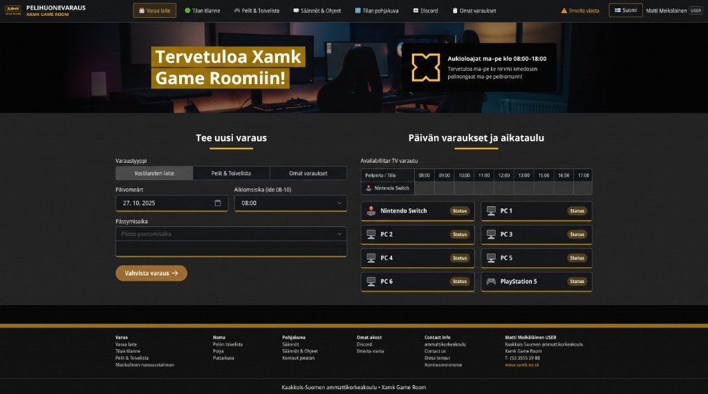
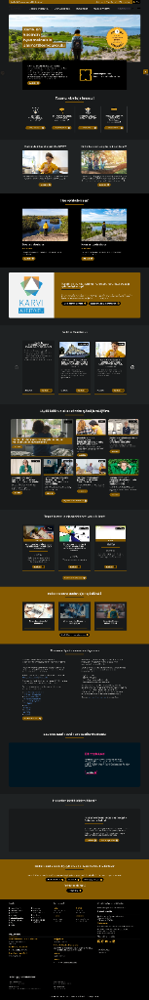

# UI & Visuaalinen Spesifikaatio — Xamk Game Room (Pelihuonevaraus)

Spec-Driven Development (SDD) -määrittely ja Cockpit-designjärjestelmä käyttöliittymälle (`src/Client/**`). Tämä dokumentti määrittelee **mitä** käyttöliittymässä rakennetaan, **miksi** jokainen rakenne ja sääntö on olemassa, sekä miten [`Docs/domain.md`](./domain.md) ja [Xamkin brändiohjeisto](https://www.xamk.fi/en/xamk-brand-guidelines/) ohjaavat toteutusta.

---

## 1. Miksi tämä UI rakennetaan? (Purpose & Problem Statement)

Kaakkois-Suomen ammattikorkeakoulun (Xamk) pelihuoneessa on rajallinen määrä laitteita (**6 kpl PC-pelipisteitä** sekä **PlayStation 5** ja **Nintendo Switch**, jotka jakavat **yhteisen 4K-television**). Ilman selkeää, reaaliaikaista ja säännöt pakottavaa käyttöliittymää syntyy kolme kriittistä ongelmaa:

1. **Tuplavaraukset ja SharedTV-ristiriidat:** Opiskelijat varaavat PS5:n ja Switchin samaan aikaan tietämättä, että molemmat konsolit käyttävät samaa fyysistä televisiota.
2. **Epäselvä tilannekuva:** Kampukselle saapuva opiskelija ei tiedä, onko pelitila vapaana, varattuna yksittäisille pelaajille vai suljettuna turnauksen/tapahtuman vuoksi.
3. **Hajautunut ylläpito:** Opettajilla (`SuperAdmin`) ja opiskelijaylläpitäjillä (`Admin`) ei ole yhtenäistä hallintapaneelia laiterikkojen, pelitoiveiden, tiedotteiden ja poikkeusvarausten (override) hoitamiseen.

**SDD-periaate käyttöliittymässä:** Käyttöliittymä ei ole pelkkä lomakekokoelma, vaan **domain-invarianttien visuaalinen ohjauskerros**. Jokainen UI-komponentti estää virheellisen tilan syntymisen jo ennen palvelinkutsua ja heijastaa palvelimen palauttamat tilat (`409 Conflict`, `ProblemDetails`) välittömästi käyttäjälle.

---

## 2. Ehdottomat perussäännöt (Non-Negotiable Invariants)

1. **Nollatoleranssi toiminnallisille regressioille:**
   - Visuaalinen tai tyylillinen muutos ei saa koskaan rikkoa olemassa olevaa sovelluslogiikkaa, tapahtumakäsittelijöitä tai tiloja.
2. **Ei hymiöitä/sarjakuvaemojeja (Zero Cartoon Emojis):**
   - Kaikki symbolit toteutetaan johdonmukaisesti **Lucide React** -vektori-ikoneilla (`lucide-react`).
3. **Korkearesoluutioiset grafiikka- ja brändiasetit:**
   - Logot ja kuvat toimitetaan terävinä vektoreina tai korkearesoluutioisina valokuvina ilman sumeita rasterileikkauksia.
4. **Monikielisyys (i18n):**
   - Kaikki tekstit haetaan `useLanguage()` -hookin kautta (`LanguageContext.tsx`) sekä `fi`- että `en`-kielille.
5. **Laitteiden nimeämisstandardi:**
   - Tietokoneet: **"PC 1" – "PC 6"**.
   - Konsolit: **"PlayStation 5"** ja **"Nintendo Switch"**.
6. **Footerin organisaatiotiedot:**
   - Alapalkissa käytetään aina virallista oppilaitos- ja tilatunnusta: *Kaakkois-Suomen ammattikorkeakoulu • Xamk Game Room* ja kampuksia *Kotka • Kouvola • Mikkeli • Savonlinna*.

---

## 3. Sanasto: Domain → UI -sillat (Ubiquitous Language)

Sama termi [`Docs/domain.md`](./domain.md) -dokumentissa, API-sopimuksessa ja React-komponenteissa:

| Domain-käsite | UI-komponentti / Näkymä | Mitä rakennetaan | Miksi juuri näin |
| :--- | :--- | :--- | :--- |
| **GameRoom** | [`FloorPlanModal.tsx`](../src/Client/src/components/FloorPlanModal.tsx), [`RealtimeStatus.tsx`](../src/Client/src/components/RealtimeStatus.tsx) | Interaktiivinen pohjapiirros ja reaaliaikainen tilannekuva koko huoneesta. | Käyttäjä hahmottaa fyysisen tilan (PC 1–6, PS5, Switch ja yhteinen TV) yhdellä silmäyksellä ennen varausta. |
| **GamingStation** | `.xamk-station-row-card` ([`BookingCalendar.tsx`](../src/Client/src/components/BookingCalendar.tsx)) | 8 laitekortin ruudukko (2×4) ja kompakti aikamatriisi. | Mahdollistaa vapaan laitteen ja kellonajan valinnan yhdellä klikkauksella ilman erillistä alasvetovalikkoa. |
| **Reservation** | [`BookingCalendar.tsx`](../src/Client/src/components/BookingCalendar.tsx), [`MyReservations.tsx`](../src/Client/src/components/MyReservations.tsx) | Varauslomake (`laite` / `koko tila`) sekä omien tulevien ja menneiden varausten hallinta. | Erottaa yksittäisen opiskelijavarauksen (max 4 h) ja koko tilan varauksen, sekä estää jo alkaneen varauksen perumisen (Sääntö #5). |
| **SharedTV** | Konsolien ristiriitatunnistin ([`BookingCalendar.tsx`](../src/Client/src/components/BookingCalendar.tsx)) | Visuaalinen varoitus ja lukitus, kun PS5 tai Switch on varattuna valitulle aikavälille. | Tekee Domain-säännön #8 (*PS5 ja Switch jakavat saman TV:n*) näkyväksi jo laitetta valittaessa. |
| **OpeningHours** | Aikaslottien suodatus (`08:00–18:00`) | Kellonaikavalitsin ja aikamatriisi näyttävät vain sallitut 30 min / 1 h aikaikkunat klo 08–18 välillä. | Estää virheelliset varausyritykset aukioloaikojen ulkopuolelle (Sääntö #2), paitsi `SuperAdmin`-tilassa. |
| **User / Guest** | [`LandingPage.tsx`](../src/Client/src/components/LandingPage.tsx), [`LoginModal.tsx`](../src/Client/src/components/LoginModal.tsx) | Kirjautumaton laskeutumissivu sekä 2-vaiheinen `@edu.xamk.fi` / `@xamk.fi` -vahvistuskoodikirjautuminen. | Suojaa varauskalenterin ja käyttäjälistat kirjautumattomilta käyttäjiltä säilyttäen tiedotteet ja aukioloajat julkisina. |
| **Admin** | [`AdminPanel.tsx`](../src/Client/src/components/AdminPanel.tsx) (`/admin/*`) | 6-välilehtinen hallintapaneeli (Pelit, Tiedotteet, Käyttäjät, Asetukset, Tilastot, Vikailmoitukset). | Keskittää päivittäisen ylläpidon yhteen URL-reititettyyn työpöytänäkymään. |
| **SuperAdmin** | [`SuperAdminPanel.tsx`](../src/Client/src/components/SuperAdminPanel.tsx) (`/superadmin`) | Pääkäyttäjän jyräysvaraus (`override`), kaikkien varausten hallinta ja roolien korotus. | Mahdollistaa opettajille tapahtumien ja turnausten luomisen aukioloajoista riippumatta (Sääntö #10). |

---

## 4. Visuaalinen Cockpit-designjärjestelmä & Xamk-brändi

Käyttöliittymä noudattaa huippumodernia **"Cockpit Dark Gaming Lounge"** -värijärjestelmää, joka perustuu kolmitasoiseen kontrastirakenteeseen ja Xamkin keltaiseen kulta-aksenttiin:

```text
┌──────────────────────────────────────────────────────────────┐
│ Taso 1: Pikimusta kehys (Navbar, Hero-ulkoalue, Footer)       │  #0e0f11 / #0a0b0d
│ ┌──────────────────────────────────────────────────────────┐ │
│ │ Taso 2: Slate Gray -keskikangas (Pääsisältöalue)          │ │  #232323 / #23262d
│ │ ┌──────────────────────┐    ┌──────────────────────────┐ │ │
│ │ │ Taso 3: Kortit/Lomake│    │ Taso 3: Aikamatriisi     │ │ │  #1b1c20 / #181a20
│ │ └──────────────────────┘    └──────────────────────────┘ │ │
│ └──────────────────────────────────────────────────────────┘ │
└──────────────────────────────────────────────────────────────┘
```

### 4.0 Referenssikuvat (Visual Reference Baseline)

#### Referenssikuva 1: Päänäkymän rakenne ja komponentit


| Alue referenssikuvassa | Mitä rakennetaan | Vastaava toteutus koodissa |
| :--- | :--- | :--- |
| **1. Yksirivinen yläpalkki (`#0e0f11`)** | Vasemmalla kultareunuksinen logo + otsikko; keskellä navigaatiolinkit kultaisella aktiivireunuksella (`#b58318`); oikealla vikailmoitus, kielenvaihtaja ja profiili. | [`Navbar.tsx`](../src/Client/src/components/Navbar.tsx), `.xamk-topbar` |
| **2. Hero-banneri & kelluva infolaatikko** | Tumma pelihuonetausta, vasemmalla kaksirivinen kultainen otsikkolaatikko, oikealla musta kelluva infolaatikko 4-lovisella `XamkXEmblem`-merkillä ja aukioloajoilla. | [`NewsBanner.tsx`](../src/Client/src/components/NewsBanner.tsx), [`LandingPage.tsx`](../src/Client/src/components/LandingPage.tsx) |
| **3. Kaksipalstainen pääsisältö (`#232323`)** | Vasemmalla **Tee uusi varaus** (päivämäärä, alkamisaika, kesto, laitevalitsin ja kultainen vahvistuspainike). Oikealla **Päivän varaukset ja aikataulu** (`08:00–17:00` -matriisi + laitekorttiruudukko). | [`BookingCalendar.tsx`](../src/Client/src/components/BookingCalendar.tsx), `src/Client/src/components/ui/*` |
| **4. 6-sarakkeinen alapalkki kultaviivalla** | Koko leveyden kultainen erotinviiva (`.xamk-footer-gold-line`), linkkiryhmät, organisaatiotiedot ja tekijänoikeuspalkki. | [`App.tsx`](../src/Client/src/App.tsx), [`LandingPage.tsx`](../src/Client/src/components/LandingPage.tsx) |

#### Referenssikuva 2: Xamk.fi — Brändin rytmi ja kortit


### 4.1 Väritokenit ja kontrastit (`src/Client/src/index.css`)
- **Xamk Keltainen / Kulta (`#fbba18` / `#e5a812` / `#d49a2a` / `#c89211`):**
  - Otsikoiden taustanauhat (`.xamk-highlight-strip`), väliotsikoiden 52px viivat (`.xamk-heading-underline`), korttien ja kenttien 2px alareuna (`border-bottom: 2px solid #c89211`), ensisijaiset toimintopainikkeet ja näppäimistöfokus.
- **Pelihuoneen tummat grafiittipinnat (`#0e0f11`, `#111111`, `#1b1c20`, `#232323`):**
  - WCAG 2.1 AA -yhteensopivat tekstikontrastit (`--text-primary: #f5f6f8`, `--text-secondary: #b0b6c2`, `--text-muted: #8b92a0`).
- **Tilavärit:**
  - Vapaa: vihreä (`#22c55e`, tumma tausta `#14532d/30`)
  - Varattu: punainen/lohenpunainen (`#ef4444`, tumma tausta `#7f1d1d/40`)
  - SharedTV-lukko: meripihka/oranssi (`#f59e0b`, tumma tausta `#78350f/40`)
  - Huoltotila: harmaa/slate (`#64748b`)

---

## 5. Arkkitehtuuri: Reititys ja `shadcn/ui`-komponenttikirjasto

### 5.1 URL-reititys (`src/Client/src/router.tsx`)
- HTML5 History API -pohjainen reititin (`RouterProvider`), joka synkronoi tilan selaushistoriaan:
  - `/book` — Varauskalenteri ja päivän aikamatriisi
  - `/status` — Reaaliaikainen tilannekuva
  - `/games` — Pelikirjasto ja yhteisön toivelista
  - `/rules` — Säännöt ja opas
  - `/my-bookings` — Omat varaukset
  - `/admin/games`, `/admin/news`, `/admin/users`, `/admin/settings`, `/admin/statistics`, `/admin/issues` — Ylläpidon hallintanäkymät
  - `/superadmin` — Pääkäyttäjän jyräys- ja poikkeusnäkymä

### 5.2 `shadcn/ui`-pohjaiset UI-primitiivit (`src/Client/src/components/ui/`)
- Uudelleenkäytettävät komponentit: `Button`, `Dialog`, `DropdownMenu`, `Tabs`, `Table`, `Card`, `Badge`, `Input`, `NativeSelect`, `Textarea`, `Label`.
- Radix UI -primitiivit takaavat esteettömyyden (fokuslukko modaaleissa, `Escape`-sulkeminen, näppäimistönavigointi, `aria-*`-tuki).
- Eksplisiittiset tyypit ja CVA-variantit (`variant="pill"`, `variant="xamk"`, `variant="station"`).

---

## 6. Näkymäkohtainen toteutus

### 6.1 Kirjautumaton tila ([`LandingPage.tsx`](../src/Client/src/components/LandingPage.tsx), [`Navbar.tsx`](../src/Client/src/components/Navbar.tsx))
- Kun `user === null`, yläpalkissa näytetään vain logo, kielenvaihtaja ja kirjautumispainike; navigaatiolinkit piilotetaan.
- Pääsivulla esitetään hero-banneri, aukioloajat, laitetiedot, interaktiivinen pohjakuva, kiinnitetyt tiedotteet ja 2-vaiheinen OTP-kirjautumislomake (`@edu.xamk.fi` / `@xamk.fi`).

### 6.2 Varauskalenteri & 8 laitteen aikamatriisi ([`BookingCalendar.tsx`](../src/Client/src/components/BookingCalendar.tsx))
- **Lomake:** Valitsee laitteen tai koko tilan, päivämäärän, alkamisajan ja keston (30 min askelein, max 4 h).
- **Aikataulumatriisi (Drag-to-Select):** Kaikki 8 laitetta (`Nintendo Switch`, `PC 1`–`PC 6`, `PlayStation 5`) listataan omilla riveillään. Käyttäjä voi valita ajan ja laitteen vetämällä hiirellä vapaiden solujen yli.
- **Konsolien SharedTV-lukko:** Jos toinen konsoli on varattu, toisen rivin vastaavat solut visualisoidaan varatuiksi eikä päällekkäisvarausta voi muodostaa.

---

## 7. Käyttöliittymän invariantit & Hyväksymiskriteerit

| # | Invariantti | Missä pakotetaan | Todennettavuus |
|---|-------------|------------------|----------------|
| **UI-1** | Kirjautumaton käyttäjä näkee vain logon, kielen ja kirjautumisen | `LandingPage.tsx`, `Navbar.tsx` | Kun `user === null`, navigaatiolinkkejä ei renderöidä |
| **UI-2** | Konsolien `SharedTV`-lukko visualisoidaan ja estää ristiriitavaraukset | `BookingCalendar.tsx` | Kun PS5 on varattu, Switch näkyy varattuna kyseiselle ajalle |
| **UI-3** | Jokaisella näkymällä on oma URL-polku | `router.tsx`, `App.tsx` | Osoiterivi päivittyy ja suorat linkit avautuvat oikeaan näkymään |
| **UI-4** | Täydellinen kaksikielisyys (`fi` / `en`) ilman raakoja avaimia | `LanguageContext.tsx` | Kielen vaihto kääntää kaikki tekstit, modaalit ja alapalkin |
| **UI-5** | 0 TypeScript- tai ESLint-virhettä/varoitusta | `src/Client/**` | `npm --prefix src/Client run build && npm --prefix src/Client run lint` palauttaa exit-koodin `0` |
| **UI-6** | Kaikkien 8 laitteen matriisi ja aikavälin maalaus hiirellä | `BookingCalendar.tsx` | Hiirellä vetäminen tuntisolujen yli päivittää laitteen ja aikavälin |
