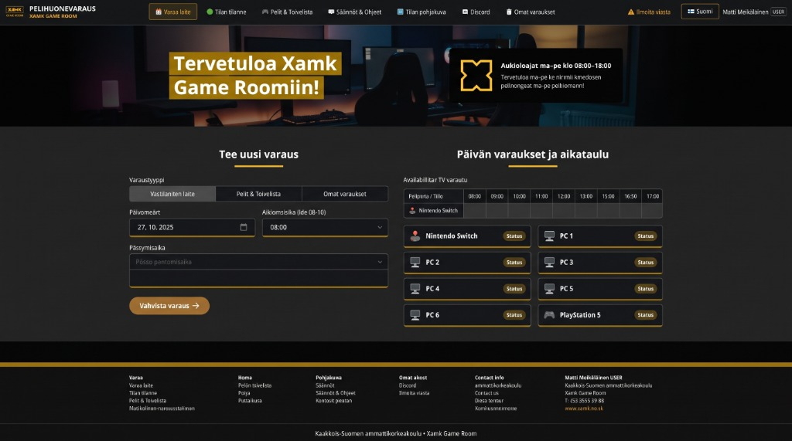

# UI ja visuaalinen spesifikaatio, Xamk Game Room (Pelihuonevaraus)

Spec-Driven Development (SDD) -määrittely ja Cockpit-designjärjestelmä käyttöliittymälle (`src/frontend/**`). Tämä dokumentti määrittelee mitä käyttöliittymässä rakennetaan, miksi jokainen rakenne ja sääntö on olemassa, sekä miten [`Docs/domain.md`](./domain.md) ja [Xamkin brändiohjeisto](https://www.xamk.fi/en/xamk-brand-guidelines/) ohjaavat toteutusta.

---

## 1. Miksi tämä käyttöliittymä rakennetaan

Kaakkois-Suomen ammattikorkeakoulun (Xamk) pelihuoneessa on rajallinen määrä laitteita (6 kpl PC-pelipisteitä sekä PlayStation 5 ja Nintendo Switch, jotka jakavat yhteisen 4K-television). Ilman selkeää, reaaliaikaista ja säännöt pakottavaa käyttöliittymää syntyy kolme ongelmaa:

1. Tuplavaraukset ja SharedTV-ristiriidat: Opiskelijat varaavat PS5:n ja Switchin samaan aikaan tietämättä, että molemmat konsolit käyttävät samaa fyysistä televisiota.
2. Epäselvä tilannekuva: Kampukselle saapuva opiskelija ei tiedä, onko pelitila vapaana, varattuna yksittäisille pelaajille vai suljettuna turnauksen tai tapahtuman vuoksi.
3. Hajautunut ylläpito: Opettajilla (`SuperAdmin`) ja opiskelijaylläpitäjillä (`Admin`) ei ole yhtenäistä hallintapaneelia laiterikkojen, pelitoiveiden, tiedotteiden ja poikkeusvarausten (override) hoitamiseen.

SDD-periaate käyttöliittymässä: Käyttöliittymä on domain-invarianttien visuaalinen ohjauskerros. Jokainen komponentti pyrkii estämään virheellisen tilan syntymisen ennen palvelinkutsua ja heijastaa palvelimen palauttamat tilat (`409 Conflict`, `ProblemDetails`) välittömästi käyttäjälle.

---

## 2. Ehdottomat perussäännöt

1. Nollatoleranssi toiminnallisille regressioille: visuaalinen tai tyylillinen muutos ei saa rikkoa olemassa olevaa sovelluslogiikkaa, tapahtumakäsittelijöitä tai tiloja.
2. Ei sarjakuvaemojeja: kaikki symbolit toteutetaan johdonmukaisesti Lucide React -vektori-ikoneilla (`lucide-react`).
3. Korkearesoluutioiset grafiikka- ja brändiasetit: logot ja kuvat toimitetaan vektoreina tai korkearesoluutioisina valokuvina ilman sumeita rasterileikkauksia.
4. Monikielisyys: kaikki tekstit haetaan `useLanguage()`-hookin kautta (`LanguageContext.tsx`) sekä `fi`- että `en`-kielille.
5. Laitteiden nimeämisstandardi: tietokoneet "PC 1" - "PC 6", konsolit "PlayStation 5" ja "Nintendo Switch".
6. Alapalkin organisaatiotiedot: alapalkissa käytetään aina virallista oppilaitos- ja tilatunnusta: Kaakkois-Suomen ammattikorkeakoulu, Xamk Game Room sekä kampukset Kotka, Kouvola, Mikkeli ja Savonlinna.

---

## 3. Sanasto: toimialuemallin ja käyttöliittymän kytkennät

Sama termi tiedostossa [`Docs/domain.md`](./domain.md), API-sopimuksessa ja React-komponenteissa:

| Domain-käsite | UI-komponentti / Näkymä | Mitä rakennetaan | Miksi juuri näin |
| :--- | :--- | :--- | :--- |
| **GameRoom** | [`FloorPlanModal.tsx`](../src/frontend/src/components/FloorPlanModal.tsx), [`RealtimeStatus.tsx`](../src/frontend/src/components/RealtimeStatus.tsx) | Interaktiivinen pohjapiirros ja reaaliaikainen tilannekuva koko huoneesta. | Käyttäjä hahmottaa fyysisen tilan (PC 1-6, PS5, Switch ja yhteinen TV) yhdellä silmäyksellä ennen varausta. |
| **GamingStation** | `.xamk-station-row-card` ([`BookingCalendar.tsx`](../src/frontend/src/components/BookingCalendar.tsx)) | 8 laitekortin ruudukko (2×4) ja kompakti aikamatriisi. | Mahdollistaa vapaan laitteen ja kellonajan valinnan yhdellä klikkauksella ilman erillistä alasvetovalikkoa. |
| **Reservation** | [`BookingCalendar.tsx`](../src/frontend/src/components/BookingCalendar.tsx), [`MyReservations.tsx`](../src/frontend/src/components/MyReservations.tsx) | Varauslomake (`laite` tai `koko tila`) sekä omien tulevien ja menneiden varausten hallinta. | Erottaa yksittäisen opiskelijavarauksen (max 4 h) ja koko tilan varauksen, sekä estää jo alkaneen varauksen perumisen (Sääntö #5). |
| **SharedTV** | Konsolien ristiriitatunnistin ([`BookingCalendar.tsx`](../src/frontend/src/components/BookingCalendar.tsx)) | Visuaalinen varoitus ja lukitus, kun PS5 tai Switch on varattuna valitulle aikavälille. | Tekee Domain-säännön #8 (*PS5 ja Switch jakavat saman TV:n*) näkyväksi laitetta valittaessa. |
| **OpeningHours** | Aikaslottien suodatus (`08:00-18:00`) | Kellonaikavalitsin ja aikamatriisi näyttävät vain sallitut 30 min ja 1 h aikaikkunat klo 08-18 välillä. | Estää virheelliset varausyritykset aukioloaikojen ulkopuolelle (Sääntö #2), paitsi `SuperAdmin`-tilassa. |
| **User / Guest** | [`LandingPage.tsx`](../src/frontend/src/components/LandingPage.tsx), [`LoginModal.tsx`](../src/frontend/src/components/LoginModal.tsx) | Kirjautumaton laskeutumissivu sekä 2-vaiheinen `@edu.xamk.fi` ja `@xamk.fi` -vahvistuskoodikirjautuminen. | Suojaa varauskalenterin ja käyttäjälistat kirjautumattomilta käyttäjiltä säilyttäen tiedotteet ja aukioloajat julkisina. |
| **Admin** | [`AdminPanel.tsx`](../src/frontend/src/components/AdminPanel.tsx), `src/frontend/src/components/admin/*` (`/admin`, `/admin/*`) | Dedikoitu neo-brutalistinen Admin Shell: kokoon taitettava sivupalkki (mobiilissa hampurilaisvalikko/drawer), yleiskatsaus-hubi KPI- ja toimintokorteilla, modaalipohjaiset lomakkeet sekä **Sivuston asetukset**. | Keskittää päivittäisen ylläpidon (Varaukset, Pelipisteet ja huolto, Vikailmoitukset, Pelit, Tiedotteet, Käyttäjät, Tilastot, Sivuston asetukset) selkeään työpöytä- ja mobiilinäkymään. |
| **SuperAdmin** | [`SuperAdminPanel.tsx`](../src/frontend/src/components/SuperAdminPanel.tsx) (`/superadmin`, `/admin/override`) | **Tapahtumavaraukset**: pääkäyttäjän viralliset tapahtumavaraukset (`override`), päällekkäisten varausten automaattinen peruutus ja roolien hallinta saman `AdminLayout`-kehyksen sisällä. | Mahdollistaa opettajille tapahtumien ja turnausten luomisen aukioloajoista riippumatta (Sääntö #10). |

---

## 4. Visuaalinen Cockpit-designjärjestelmä ja Xamk-brändi

Käyttöliittymä noudattaa Cockpit Dark Gaming Lounge -värijärjestelmää, joka perustuu kolmitasoiseen kontrastirakenteeseen ja Xamkin keltaiseen kulta-aksenttiin:

```text
┌──────────────────────────────────────────────────────────────┐
│ Taso 1: Pikimusta kehys (Navbar, Hero-ulkoalue, Footer)       │  #0e0f11 / #0a0b0d
│ ┌──────────────────────────────────────────────────────────┐ │
│ │ Taso 2: Slate Gray -keskikangas (Pääsisältöalue)          │ │  #232323 / #23262d
│ │ ┌──────────────────────┐    ┌──────────────────────────┐ │ │
│ │ │ Taso 3: Kortit/Lomake│    │ Taso 3: Aikamatriisi     │ │ │  #1b1c20 / #181a20
│ │ └──────────────────────┘    └──────────────────────────┘ │ │
│ └──────────────────────────────────────────────────────────┘ │
└──────────────────────────────────────────────────────────────┘
```

### 4.0 Referenssikuvat

#### Referenssikuva 1: Päänäkymän rakenne ja komponentit


| Alue referenssikuvassa | Mitä rakennetaan | Vastaava toteutus koodissa |
| :--- | :--- | :--- |
| **1. Yksirivinen yläpalkki (`#0e0f11`)** | Vasemmalla kultareunuksinen logo ja otsikko; keskellä navigaatiolinkit kultaisella aktiivireunuksella (`#b58318`); oikealla vikailmoitus, kielenvaihtaja ja profiili. | [`Navbar.tsx`](../src/frontend/src/components/Navbar.tsx), `.xamk-topbar` |
| **2. Hero-banneri ja kelluva infolaatikko** | Tumma pelihuonetausta, vasemmalla kaksirivinen kultainen otsikkolaatikko, oikealla musta kelluva infolaatikko 4-lovisella `XamkXEmblem`-merkillä ja aukioloajoilla. | [`NewsBanner.tsx`](../src/frontend/src/components/NewsBanner.tsx), [`LandingPage.tsx`](../src/frontend/src/components/LandingPage.tsx) |
| **3. Kaksipalstainen pääsisältö (`#232323`)** | Vasemmalla Tee uusi varaus (päivämäärä, alkamisaika, kesto, laitevalitsin ja kultainen vahvistuspainike). Oikealla Päivän varaukset ja aikataulu (`08:00-17:00` -matriisi ja laitekorttiruudukko). | [`BookingCalendar.tsx`](../src/frontend/src/components/BookingCalendar.tsx), `src/frontend/src/components/ui/*` |
| **4. 6-sarakkeinen alapalkki kultaviivalla** | Koko leveyden kultainen erotinviiva (`.xamk-footer-gold-line`), linkkiryhmät, organisaatiotiedot ja tekijänoikeuspalkki. | [`App.tsx`](../src/frontend/src/App.tsx), [`LandingPage.tsx`](../src/frontend/src/components/LandingPage.tsx) |

#### Referenssikuva 2: Xamk.fi, brändin rytmi ja kortit


### 4.1 Väritokenit ja kontrastit (`src/frontend/src/index.css`)
- Xamk Keltainen ja Kulta (`#fbba18`, `#e5a812`, `#d49a2a`, `#c89211`):
  - Otsikoiden taustanauhat (`.xamk-highlight-strip`), väliotsikoiden 52px viivat (`.xamk-heading-underline`), korttien ja kenttien 2px alareuna (`border-bottom: 2px solid #c89211`), ensisijaiset toimintopainikkeet ja näppäimistöfokus.
- Pelihuoneen tummat grafiittipinnat (`#0e0f11`, `#111111`, `#1b1c20`, `#232323`):
  - WCAG 2.1 AA -yhteensopivat tekstikontrastit (`--text-primary: #f5f6f8`, `--text-secondary: #b0b6c2`, `--text-muted: #8b92a0`).
- Tilavärit:
  - Vapaa: vihreä (`#22c55e`, tumma tausta `#14532d/30`)
  - Varattu: punainen (`#ef4444`, tumma tausta `#7f1d1d/40`)
  - SharedTV-lukko: meripihka tai oranssi (`#f59e0b`, tumma tausta `#78350f/40`)
  - Huoltotila: harmaa (`#64748b`)

---

## 5. Arkkitehtuuri: reititys ja komponenttikirjasto

### 5.1 URL-reititys (`src/frontend/src/router.tsx`)
HTML5 History API -pohjainen reititin (`RouterProvider`), joka synkronoi tilan selaushistoriaan:
- `/book`: Varauskalenteri ja päivän aikamatriisi
- `/status`: Reaaliaikainen tilannekuva (päivämäärävalintapalkki + 8 pelipistekorttia, SignalR-päivitykset)
- `/games`: Pelikirjasto ja yhteisön toivelista
- `/rules`: Säännöt ja opas
- `/my-bookings`: Omat varaukset
- `/admin`: Ylläpidon yleiskatsaus-hubi (KPI-kortit ja ryhmitellyt toimintokortit)
- `/admin/reservations`, `/admin/stations`, `/admin/issues`, `/admin/games`, `/admin/news`, `/admin/users`, `/admin/statistics`, `/admin/settings` (*Sivuston asetukset*): Ylläpidon hallintanäkymät sivupalkin kautta
- `/superadmin` (ja `/admin/override`): Pääkäyttäjän **Tapahtumavaraukset**-näkymä saman `AdminLayout`-kehyksen sisällä

### 5.2 UI-primitiivit (`src/frontend/src/components/ui/`)
- Uudelleenkäytettävät komponentit: `Button`, `Dialog`, `DropdownMenu`, `Tabs`, `Table`, `Card`, `Badge`, `Input`, `NativeSelect`, `Textarea`, `Label`.
- Radix UI -primitiivit takaavat esteettömyyden (fokuslukko modaaleissa, `Escape`-sulkeminen, näppäimistönavigointi, `aria-*`-tuki).
- Eksplisiittiset tyypit ja CVA-variantit (`variant="pill"`, `variant="xamk"`, `variant="station"`).

---

## 6. Näkymäkohtainen toteutus

### 6.1 Kirjautumaton tila ([`LandingPage.tsx`](../src/frontend/src/components/LandingPage.tsx), [`Navbar.tsx`](../src/frontend/src/components/Navbar.tsx))
- Kun `user === null`, yläpalkissa näytetään vain logo, kielenvaihtaja ja kirjautumispainike; navigaatiolinkit piilotetaan.
- Pääsivulla esitetään hero-banneri, aukioloajat, laitetiedot, interaktiivinen pohjakuva, kiinnitetyt tiedotteet ja 2-vaiheinen OTP-kirjautumislomake (`@edu.xamk.fi` ja `@xamk.fi`).

### 6.2 Varauskalenteri ja 8 laitteen aikamatriisi ([`BookingCalendar.tsx`](../src/frontend/src/components/BookingCalendar.tsx))
- Lomake: Valitsee laitteen tai koko tilan, päivämäärän, alkamisajan ja keston (30 min askelein, max 4 h).
- Aikataulumatriisi (Drag-to-Select): Kaikki 8 laitetta (`Nintendo Switch`, `PC 1`-`PC 6`, `PlayStation 5`) listataan omilla riveillään. Käyttäjä voi valita ajan ja laitteen vetämällä hiirellä vapaiden solujen yli.
- Konsolien SharedTV-lukko: Jos toinen konsoli on varattu, toisen rivin vastaavat solut visualisoidaan varatuiksi eikä päällekkäisvarausta voi muodostaa.

---

## 7. Käyttöliittymän invariantit ja hyväksymiskriteerit

| # | Invariantti | Missä pakotetaan | Todennettavuus |
|---|-------------|------------------|----------------|
| **UI-1** | Kirjautumaton käyttäjä näkee vain logon, kielen ja kirjautumisen | `LandingPage.tsx`, `Navbar.tsx` | Kun `user === null`, navigaatiolinkkejä ei renderöidä |
| **UI-2** | Konsolien `SharedTV`-lukko visualisoidaan ja estää ristiriitavaraukset | `BookingCalendar.tsx` | Kun PS5 on varattu, Switch näkyy varattuna kyseiselle ajalle |
| **UI-3** | Jokaisella näkymällä on oma URL-polku | `router.tsx`, `App.tsx` | Osoiterivi päivittyy ja suorat linkit avautuvat oikeaan näkymään |
| **UI-4** | Kaksikielisyys (`fi` ja `en`) ilman raakoja avaimia | `LanguageContext.tsx` | Kielen vaihto kääntää kaikki tekstit, modaalit ja alapalkin |
| **UI-5** | 0 TypeScript- tai ESLint-virhettä ja varoitusta | `src/frontend/**` | `npm --prefix src/frontend run build && npm --prefix src/frontend run lint` palauttaa exit-koodin `0` |
| **UI-6** | Kaikkien 8 laitteen matriisi ja aikavälin maalaus hiirellä | `BookingCalendar.tsx` | Hiirellä vetäminen tuntisolujen yli päivittää laitteen ja aikavälin |
