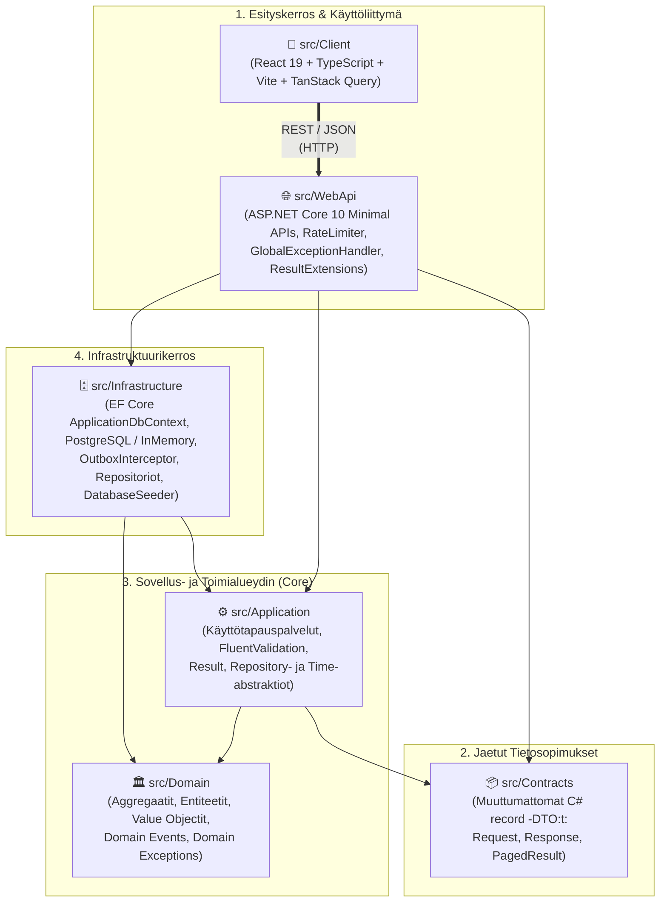
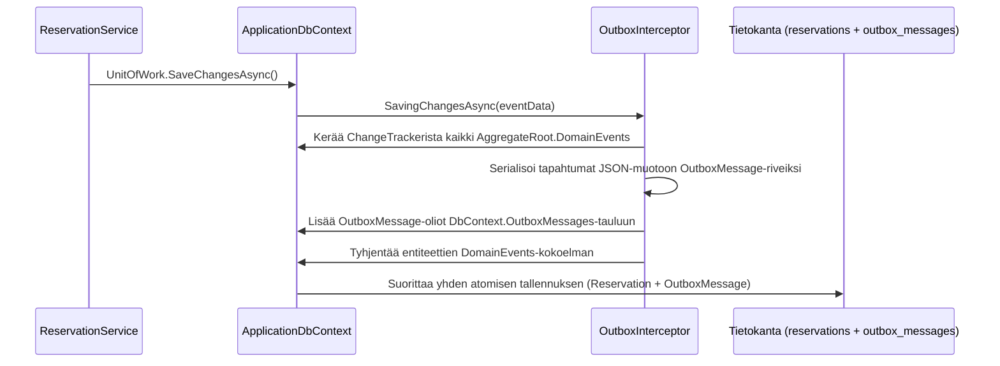

# 🏛️ Järjestelmäarkkitehtuuri (`arkkitehtuuri.md`)

Tämä dokumentti kuvaa **Pelihuonevaraus (Xamk Game Room)** -järjestelmän ohjelmistoarkkitehtuurin, kerrosjaon, suunnittelumallit (Design Patterns), tietokantatason rinnakkaisuudenhallinnan, virheenkäsittelyn, tietoturvan sekä käännösaikaiset laatupalomuurit.

---

## 1. Arkkitehtuuriperiaatteet

Järjestelmä on toteutettu **Clean Architecture** (Onion / Ports & Adapters) ja **Taktinen Domain-Driven Design (DDD)** -periaatteilla.

1. **Riippuvuuksien kääntäminen (Dependency Inversion Principle):**
   - Sisemmät kerrokset (`Domain`, `Application`) määrittelevät abstraktiot (`IReservationRepository`, `IUnitOfWork`, `IDateTimeProvider`), ja ulompi `Infrastructure`-kerros toteuttaa ne.
   - `Domain`-kerroksella on **0 ulkoista NuGet- tai kehysriippuvuutta**.
2. **Kerroskohtainen DI-eristys (Dependency Injection Isolation):**
   - Jokainen kerros rekisteröi omat palvelunsa omaan laajennusmetodiinsa:
     - [`src/Application/DependencyInjection.cs`](../src/Application/DependencyInjection.cs) → `services.AddApplication()`
     - [`src/Infrastructure/DependencyInjection.cs`](../src/Infrastructure/DependencyInjection.cs) → `services.AddInfrastructure(configuration)`
   - Esityskerros ([`src/WebApi/Program.cs`](../src/WebApi/Program.cs)) vain kutsuu näitä laajennusmetodeja sekä kytkee HTTP-putken.
3. **Poikkeukseton ohjausrakenne (`Result<T>`-malli):**
   - Liiketoimintavirheitä (validointi, päällekkäinen varaus, käyttöesto, puuttuva resurssi) ei käsitellä kalliilla `try/catch`-poikkeuksilla, vaan tyyppiturvallisella [`Result<T>`](../src/Application/Common/Result.cs)- ja [`Error`](../src/Application/Common/Error.cs)-rakenteella.

---

## 2. Projektirakenne ja Kerrosten Vastuut

### Kerroskohtainen erittely

| Projekti / Kansio | Sijainti | Sallitut riippuvuudet | Keskeinen vastuu |
| :--- | :--- | :--- | :--- |
| **`Pelihuone.Domain`** | `src/Domain/` | *Ei yhtään* | Liiketoimintainvariantit, vahvasti tyypitetyt ID:t (`UserId`, `ReservationId`, `GamingStationId`, `GameRoomId`), arvo-objektit (`TimeWindow`, `OpeningHours`, `SchoolEmail`), juurientiteetit (`Reservation`, `User`, `GamingStation`, `GameRoom`, `Game`, `News`, `IssueReport`) ja domain-tapahtumat (`IDomainEvent`). |
| **`Pelihuone.Contracts`** | `src/Contracts/` | *Ei yhtään* | Julkisen REST-rajapinnan ja sovelluspalveluiden väliset syöte- ja vastaustietueet (`record`) sekä sivutusmalli [`PagedResult<T>`](../src/Contracts/Common/PagedResult.cs). |
| **`Pelihuone.Application`** | `src/Application/` | `Domain`, `Contracts`, `FluentValidation` | Käyttötapauskohtainen orkestrointi (`ReservationService`, `UserService`, `GamingStationService`, `GameService`, `NewsService`, `SettingsService`, `StatisticsService`, `IssueReportService`, `DiscordNotificationService`), syötteiden validointi ja repositorioiden rajapinnat (`Abstractions/Repositories/`). |
| **`Pelihuone.Infrastructure`** | `src/Infrastructure/` | `Application`, `Domain`, `EF Core`, `Npgsql` | Tietokantakonteksti ([`ApplicationDbContext`](../src/Infrastructure/Persistence/ApplicationDbContext.cs)), EF Core Fluent API -määritykset (`Configurations/`), `OutboxInterceptor`, repositoriototeutukset, `SystemDateTimeProvider` ja `DatabaseSeeder`. |
| **`Pelihuone.WebApi`** | `src/WebApi/` | `Application`, `Infrastructure`, `Contracts` | HTTP-reititys (`Endpoints/`), Rate Limiting, CORS, globaali virheenkäsittely ([`GlobalExceptionHandler`](../src/WebApi/Middleware/GlobalExceptionHandler.cs)) ja `Result<T>`-tulosten muuntaminen RFC 9457 `ProblemDetails` -vastauksiksi. |
| **`Client` (Frontend)** | `src/Client/` | React 19, TanStack Query, Tailwind, Radix UI | Mobiilioptimoitu (Mobile-First) yksisivuinen web-sovellus (SPA), interaktiivinen varauskalenteri (`Drag-to-Select`), reaaliaikainen tilanäkymä, pelikatalogi ja 6-välilehtinen Admin-hallintapaneeli. |

---

## 3. Taktinen Domain-Driven Design (DDD) `src/Domain`-kerroksessa

### 3.1 Juurientiteetit (`AggregateRoot<TId>`) ja Entiteetit (`Entity<TId>`)
Kaikki entiteetit perivät [`Entity<TId>`](../src/Domain/Common/Entity.cs)-perusluokan ja aggregaattijuuret [`AggregateRoot<TId>`](../src/Domain/Common/AggregateRoot.cs)-luokan, joka ylläpitää listaa julkaisemattomista domain-tapahtumista (`IReadOnlyCollection<IDomainEvent> DomainEvents`).

- **[`Reservation`](../src/Domain/Models/Reservation.cs):** Varausjärjestelmän keskeisin aggregaatti. Varmistaa luontihetkellä (`Reservation.Create`):
  - Yksittäisvarauksella (`ReservationType.Individual`) on oltava `GamingStationId` eikä `GameRoomId`:tä.
  - Koko tilan (`ReservationType.Room`) ja tapahtuman (`ReservationType.Event`) varauksella on oltava `GameRoomId` eikä yksittäistä `GamingStationId`:tä.
  - Luonti nostaa automaattisesti [`ReservationCreatedDomainEvent`](../src/Domain/Events/ReservationCreatedDomainEvent.cs)-tapahtuman ja peruutus (`Cancel`) [`ReservationCancelledDomainEvent`](../src/Domain/Events/ReservationCancelledDomainEvent.cs)-tapahtuman.
- **[`User`](../src/Domain/Models/User.cs):** Hallinnoi käyttäjän validoitua koulusähköpostia (`SchoolEmail`), roolia (`User`, `Admin`, `SuperAdmin`) sekä käyttöestoja (`BannedUntilUtc`, `BanReason`, `IsBanned(nowUtc)`, `Ban(...)`, `Unban()`). Estää `SuperAdmin`-käyttäjän bannaamisen domain-tasolla.
- **[`GamingStation`](../src/Domain/Models/GamingStation.cs):** Edustaa fyysistä pelipistettä (PC 1–6, PS5, Switch), sen laitekoodia (`PC-01`..`SW-01`), jaetun television riippuvuutta (`UsesSharedTv`) ja huoltotilaa (`IsActive`, `Activate()`, `Deactivate()`).

### 3.2 Arvo-objektit (`Value Objects`)
- **[`TimeWindow`](../src/Domain/ValueObjects/TimeWindow.cs):** Muuttumaton aikaväli (`StartUtc`, `EndUtc`), joka pakottaa `EndUtc > StartUtc` ja tarjoaa `OverlapsWith(TimeWindow other)` -leikkaustarkistuksen.
- **[`SchoolEmail`](../src/Domain/ValueObjects/SchoolEmail.cs):** Sallii ainoastaan `@edu.xamk.fi`- ja `@xamk.fi`-päätteiset sähköpostiosoitteet ja normalisoi ne pieniksi kirjaimiksi.
- **[`OpeningHours`](../src/Domain/ValueObjects/OpeningHours.cs):** Kapseloi Suomen aikavyöhykkeen (`Europe/Helsinki` / `FLE Standard Time`) aukiolotarkistuksen, arkipäiväsäännön ja 15 minuutin joustovaran (`GracePeriod`).

---

## 4. Tietokanta, Rinnakkaisuudenhallinta ja Transactional Outbox

### 4.1 Kaksoistietokantatuki (PostgreSQL & InMemory Fallback)
[`DependencyInjection.AddInfrastructure`](../src/Infrastructure/DependencyInjection.cs) tarkistaa käynnistyksen yhteydessä PostgreSQL-yhteyden:
- **Tuotanto ja Integraatiotestit (`Testcontainers`):** Käyttää PostgreSQL-kantaa (`UseNpgsql`), tallentaa kaikki aikaleimat `timestamptz`-sarakkeina ja ottaa käyttöön PostgreSQL:n järjestelmäsarakkeen `xmin` optimistiseen rivilukitukseen (`UseXminAsConcurrencyToken()`).
- **Paikallinen kehitysympäristö ilman Dockeria:** Siirtyy automaattisesti käyttämään EF Coren muistitietokantaa (`UseInMemoryDatabase("PelihuoneDevDb")`) ja alustaa sen [`DatabaseSeeder`](../src/Infrastructure/Persistence/DatabaseSeeder.cs)-luokalla.

### 4.2 Transactional Outbox -kuvio (`OutboxInterceptor`)
Jotta yksikään varausilmoitus tai domain-tapahtuma ei katoa tietokantatransaktion ja ulkoisen viestinvälityksen välillä, [`OutboxInterceptor`](../src/Infrastructure/Outbox/OutboxInterceptor.cs) sieppaa `SaveChangesAsync`-kutsun:

---

## 5. Dynaamiset Tilasäännöt ja Asetusarkkitehtuuri (`SettingsService`)

Ylläpitäjän Admin-paneelissa määrittelemät tilasäännöt ja kiintiöt tallennetaan [`SettingsService`](../src/Application/Settings/SettingsService.cs)-palvelun kautta paikalliseen `site-settings.json`-tiedostoon ja luetaan jokaisen varauksen yhteydessä:
- **Aukioloajat ja aukiolopäivät:** `OpenTimeHour` (0–23), `CloseTimeHour` (1–24), `OnlyWeekdays` (Ma–Pe vs. Ma–Su).
- **Varauskiintiöt:** `MaxAdvanceBookingMonths` (1–12 kk), `MaxIndividualHours` (1–12 h/vrk), `MaxStudentRoomHours` (1–12 h), `MinReservationMinutes` (15–120 min).
- **Laiteriippuvuudet ja huoltotila:** `EnforceSharedTvLock` (PS5 & Switch jaetun TV:n lukitus) sekä `IsMaintenanceMode` + `MaintenanceMessage` (koko pelitilan tilapäinen sulku opiskelijoilta).

---

## 6. Roolitukset, Käyttöoikeusarkkitehtuuri (RBAC) ja Luvat

Järjestelmän valtuutusmalli (Authorization) on monikerroksinen: oikeudet tarkistetaan sekä HTTP-päätepisteissä (`X-User-Id`), sovelluspalveluissa (`ReservationService`, `UserService`) että domain-entiteettien sisäisissä invarianteissa (`User`, `OpeningHours`).

### 6.1 Roolihierarkia (`UserRole`)

1. **`UserRole.User` (`0` — Opiskelija / Henkilökunta):**
   - Tunnistautuu oppilaitoksen sähköpostilla (`@edu.xamk.fi` tai `@xamk.fi`).
   - Saa luoda yksittäisiä laitevarauksia (`ReservationType.Individual`, oletuskiintiö enintään `4 h / vrk`) sekä koko pelitilan varauksia (`ReservationType.Room`, oletuskiintiö enintään `4 h`).
   - On sidottu voimassa oleviin aukioloaikoihin (oletus Ma–Pe klo 08:00–18:00), ennakkovarausrajaan (`2 kk`) sekä tilan ja laitteiden huoltotilaan.
   - Saa peruuttaa vain **omia** varauksiaan (`reservation.UserId == currentUser.Id`, estää IDOR-haavoittuvuudet).
2. **`UserRole.Admin` (`1` — Tilanvalvoja / Ylläpitäjä):**
   - Sisältää ominaisuuden `user.IsAdmin == true`.
   - Pääsee Admin-hallintapaneeliin (`AdminPanel.tsx`) ja saa kutsua ylläpidon REST-päätepisteitä (`X-User-Id`).
   - Saa tehdä koko tilan (`Room`) ja tapahtuman (`Event`) varauksia ilman opiskelijan tuntikiintiötä sekä tilan ollessa huoltotilassa (`IsMaintenanceMode`).
   - Saa peruuttaa kenen tahansa käyttäjän varauksen, hallita pelejä, toivelistaa, tiedotteita, tilastoja, vikailmoituksia, varauskiintiöitä (`PUT /api/settings`), laitehuoltoja (`PUT /api/stations/{id}/status`) sekä **asettaa ja poistaa käyttäjien määräaikaisia tai pysyviä käyttöestoja / banneja** (`PUT /api/users/{id}/ban`).
   - **Rajoitukset:** `Admin` **ei voi** muuttaa käyttäjien rooleja (`PUT /api/users/{id}/role`), **ei voi** jyrätä olemassa olevia varauksia (`POST /api/reservations/override`) **eikä voi** ohittaa aukioloaikoja.
3. **`UserRole.SuperAdmin` (`2` — Pääkäyttäjä):**
   - Sisältää ominaisuudet `user.IsSuperAdmin == true` ja `user.IsAdmin == true`.
   - **Aukioloaikojen ohitus (`allowAnytime = true`):** Saa luoda varauksia mihin vuorokaudenaikaan tahansa ja myös viikonloppuisin.
   - **Jyräysvaltuus (`POST /api/reservations/override`):** Saa pakkovarata tilan tai laitteen tapahtumalle, jolloin järjestelmä peruuttaa automaattisesti kaikki aikavälille osuvat opiskelijavaraukset perustelun kera.
   - **Roolien hallinta (`PUT /api/users/{id}/role`):** Ainoa rooli, joka voi ylentää tai alentaa käyttäjiä `User`- ja `Admin`-tasojen välillä.
   - **Lukittu suojaustaso:** `SuperAdmin`-tiliä ei voi bannata (`User.Ban` heittää `DomainException`-poikkeuksen).

### 6.2 Käyttöestot / Bannaus (`BannedUntilUtc` & `IsBanned`)
- Ylläpitäjä (`Admin` tai `SuperAdmin`) voi asettaa käyttäjälle määräaikaisen (`1 h`, `3 h`, `12 h`, `24 h`, `72 h`, `7 vrk`, `14 vrk`, `30 vrk`, `90 vrk`) tai pysyvän (`+100 vuotta`) käyttöeston sekä kirjata sille syyn (`BanReason`).
- Kun `user.IsBanned(nowUtc)` on tosi, sekä sisäänkirjautuminen (`UserService.AuthenticateOrCreateUserAsync`) että uusien varausten luominen (`ReservationService.CreateReservationAsync`) palauttavat `Error.Forbidden("User.Banned")` (`HTTP 403 Forbidden`) selkeällä ilmoituksella bannin päättymisajasta ja syystä.

---

## 7. Virheenkäsittely, Hälytykset, Tietoturva ja Rate Limiting

1. **RFC 9457 `ProblemDetails`:**
   - Kaikki palvelukerroksen `Result.Failure(Error)`-tulokset muunnetaan [`ResultExtensions.ToHttpResult`](../src/WebApi/Extensions/ResultExtensions.cs)-laajennusmetodilla standardinmukaiseksi `application/problem+json` -vastaukseksi:
     - `ErrorType.Validation` → `400 Bad Request`
     - `ErrorType.Unauthorized` → `401 Unauthorized`
     - `ErrorType.Forbidden` → `403 Forbidden` (esim. bannattu käyttäjä tai puuttuva rooli)
     - `ErrorType.NotFound` → `404 Not Found`
     - `ErrorType.Conflict` → `409 Conflict` (esim. laite varattu, SharedTV-ristiriita tai huoltotila)
   - Odottamattomat poikkeukset sieppaa [`GlobalExceptionHandler`](../src/WebApi/Middleware/GlobalExceptionHandler.cs), joka lokittaa virheen palvelimella mutta palauttaa asiakkaalle turvallisen `500 Internal Server Error` -`ProblemDetails`-vastauksen ilman pinojälkiä (Stack Trace).

### 7.1 Automaattinen virhe- ja kaatumishälytysjärjestelmä ylläpidolle (Admin/SuperAdmin Alerting)
Järjestelmä sisältää automaattisen hälytysputken ([`IErrorNotificationService`](../src/Application/Notifications/IErrorNotificationService.cs)), joka valvoo sekä HTTP-pyyntöjä että prosessitason poikkeuksia:
- **Käsittelemättömät HTTP 500 -poikkeukset:** [`GlobalExceptionHandler`](../src/WebApi/Middleware/GlobalExceptionHandler.cs) laukaisee automaattisen sähköpostihälytyksen kaikista palvelinvirheistä (toimialuesäännöistä johtuvat `DomainException`-400-virheet rajataan pois hälytyksistä).
- **Prosessitason kaatumiset (Unhandled Process Crashes):** [`src/WebApi/Program.cs`](../src/WebApi/Program.cs) kuuntelee `AppDomain.CurrentDomain.UnhandledException`-tapahtumaa. Mikäli taustasäie tai CLR-prosessi kaatuu fataliin virheeseen, järjestelmä lähettää hätähälytyksen ennen prosessin alasajoa.
- **Vastaanottajien dynaaminen resoluutio ja vikasietoisuus (Resilience):** Palvelu hakee tietokannasta kaikkien aktiivisten `Admin`- ja `SuperAdmin`-käyttäjien sähköpostiosoitteet. Jos tietokanta on alhaalla tai yhteys poikki, järjestelmä käyttää automaattisesti konfiguroitua varasähköpostia (`Alerts:AdminEmail` / `Smtp:AdminEmail` / `Smtp:FromEmail`).
- **Spämmisuojaus ja jäähdytysaika (Spam Throttling):** Identtisille virheille on toteutettu muistipohjainen 60 sekunnin `AlertCooldown`. Tämä estää sähköpostitulvan, jos toistuva silmukka tai taustaprosessi aiheuttaa jatkuvaa virhetilaa.
- **Rakenteinen HTML-virheraportti:** Viesti sisältää selkeän värikoodatun kortin, UTC-aikaleiman, poikkeuksen täyden tyyppinimen, virheviestin, HTTP-polun, Trace ID:n palvelinlokeihin linkittämistä varten, palvelimen isäntäkoneen tiedot sekä täydellisen pinojäljen (Stack Trace) ja sisäiset poikkeukset.
- **SMTP & Kehitysympäristön simulaatio:** [`SmtpEmailSender`](../src/Infrastructure/Services/Email/SmtpEmailSender.cs) lähettää viestit oikealla SMTP-palvelimella. Mikäli SMTP-isäntää ei ole konfiguroitu (paikallinen kehitys), lähetys simuloidaan turvallisesti sovelluslokiin.

2. **Rate Limiting (Spämmi- ja bottisuojaus):**
   - `AuthPolicy`: Enintään **5 pyyntöä / minuutti / IP** kirjautumis- ja OTP-koodipäätepisteisiin.
   - `ReservationPolicy`: Enintään **10 pyyntöä / minuutti / IP** varauspäätepisteisiin.
3. **GDPR ja PII-suojaus:**
   - Palvelinlokeihin (`ILogger`) ei koskaan kirjoiteta käyttäjien nimiä tai sähköpostiosoitteita — ainoastaan anonyymit `UserId`- ja `ReservationId`-GUID-tunnisteet.

---

## 8. Kääntäjäpalomuuri ja Koodin Laatuvaatimukset

Projektin juuressa olevat [`.editorconfig`](../.editorconfig) ja [`Directory.Build.props`](../Directory.Build.props) sekä frontendin [`tsconfig.app.json`](../src/Client/tsconfig.app.json) ja [`eslint.config.js`](../src/Client/eslint.config.js) muodostavat automaattisen laatupalomuurin:

- **`TreatWarningsAsErrors=true` & `EnforceCodeStyleInBuild=true`:** Yksikään kääntäjä- tai tyylivaroitus ei mene käännöksestä läpi.
- **Eksplisiittisten tyyppien pakotus (`IDE0008 = error`, `no-var = error`):** `var`-avainsanan käyttö on kokonaan kielletty sekä C#- että TypeScript-koodissa.
- **Pakollinen suomenkielinen dokumentointi (`GenerateDocumentationFile=true` / `CS1591`):** Jokaisella julkisella luokalla, tietueella, rajapinnalla, metodilla ja ominaisuudella on oltava suomenkieliset XML-/JSDoc-kommentit.

---

## 9. Kiellot, Elinkaari, Ei-tavoitteet ja Valmis-kriteerit

### Kiellot

1. **Älä tarkista päällekkäisyyttä, aukioloaikoja tai peruutusoikeutta HTTP-päätepisteessä (`Endpoints/`).** Jokaisella säännöllä on oma `Paikka` `Docs/domain.md`:ssä.
2. **Älä vie EF Corea, Npgsql:ää tai HTTP-kirjastoja `src/Domain`-projektiin.**
3. **Älä anna `WebApi`-päätepisteiden kutsua repositorioita ohi `Application`-palveluiden.**
4. **Älä kutsu järjestelmän kelloa (`DateTime.Now` / `DateTimeOffset.UtcNow`) suoraan `Domain`- tai `Application`-kerroksissa.** Nykyhetki annetaan parametrina tai `IDateTimeProvider`-rajapinnan kautta.
5. **Älä tallenna "vapaana nyt" -tilaa tietokantaan.** Se lasketaan aktiivisista varauksista, laitteiden tilasta ja `UsesSharedTv`-riippuvuudesta.
6. **Älä palauta Domain-entiteettejä suoraan HTTP-rajapinnasta.** Käytä aina `src/Contracts`-projektin DTO-tietueita.

### Elinkaari

Muistissa pidetty tietokanta (`UseInMemoryDatabase`) elää prosessin ajan paikallisessa kehityksessä ilman Dockeria, jotta tila säilyy pyyntöjen välillä. PostgreSQL-tietokantaan kytketty `ApplicationDbContext` ja repositoriot rekisteröidään `Scoped`-elinkaarella (yksi HTTP-pyyntö kerrallaan), jotta rinnakkaiset pyynnöt eivät jaa samaa `DbContext`-instanssia.

### Ei-tavoitteet

- Ei maksullisia varauksia tai maksupääteintegraatiota.
- Ei automaattista toistuvaa viikkovarausta opiskelijoille (estää vakiovuorojen hamstraamisen).
- Ei ulkopuolisten sähköpostiosoitteiden (`@gmail.com` jne.) kirjautumista.
- Ei useamman kampuksen erillisiä huoneita tässä versiossa (tietomalli `GameRoom` on valmiina laajennukseen).

### Valmis

Sanoin, ei skriptinä:

- Toinen varaus samalle pelipisteelle samalle aikavälille hylätään tilakoodilla `409 Conflict` (`Reservation.StationOverlap`) ja vastaus kertoo syyn.
- Kun `PlayStation 5` on varattu klo 14–16, `Nintendo Switch` ei ole vapaana samalle välille ja sen varausyritys palauttaa `409 Conflict` (`Reservation.SharedTvConflict`).
- `SuperAdmin`-käyttäjän luoma tapahtumavaraus (`override`) peruuttaa samalle aikavälille osuvat opiskelijavaraukset ja kirjaa niihin annetun peruutussyyn (`ADR 0001`).
- Jo alkaneen tai menneen varauksen peruminen hylätään `Reservation`-entiteetissä (`409 Conflict`).
- Domain-sääntöjen (#1, #4, #5, #9, #11) yksikkötestit eivät käynnistä web-palvelinta eivätkä avaa tietokantaa.

